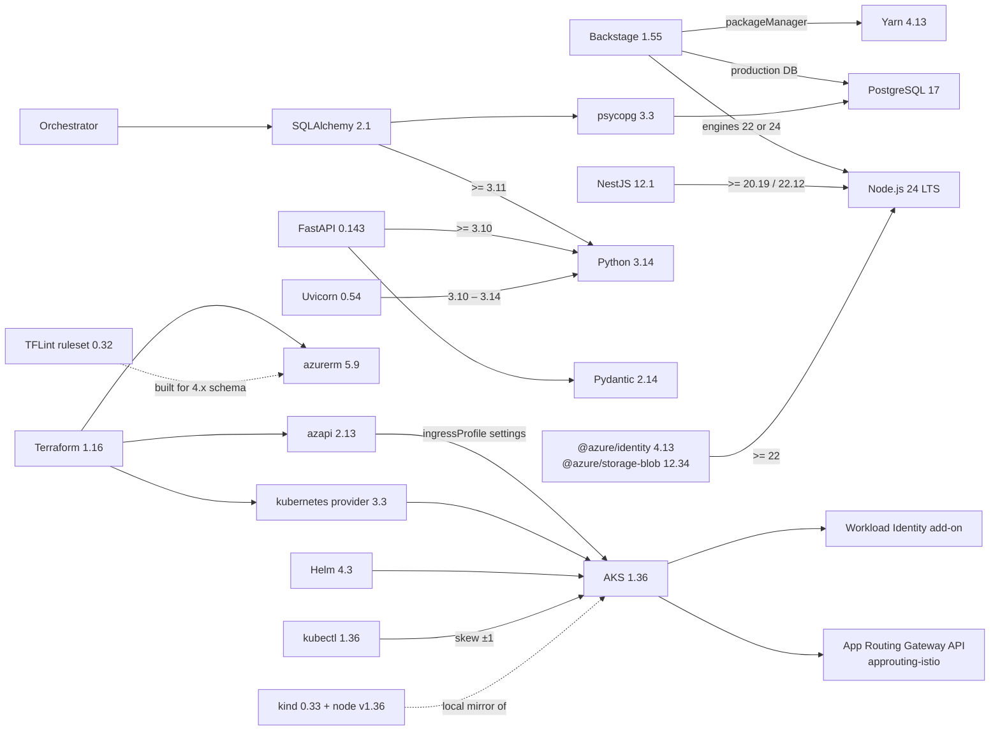

# Component compatibility plan

The component versions chosen for Sportify Azure Backstage milestone 1, why each was chosen, and how they depend on each other. Related documents: [README](README.md), [implementation plan](IMPLEMENTATION_PLAN.md), [ADR-0002 Terraform structure](docs/adr/0002-terraform-structure.md) and [ADR-0003 ingress](docs/adr/0003-ingress-gateway-api.md).

- **Verified on:** 2026-10-10, against each project's official release page, registry or documentation (see [Sources](#sources)).
- **Rule:** use the newest release that every dependent component supports, not simply the newest release. Where the newest release is not adopted, the reason is given.
- **Pinning:** exact versions go in lock files (`yarn.lock`, `uv.lock`, `.terraform.lock.hcl`, Helm `Chart.lock`). Manifests use the ranges shown here, and GitHub Actions are pinned to commit SHAs.

Container footprint update (2026-10-13): the Python HTTP services now request base FastAPI and Uvicorn
packages, without optional `standard` extras. Package version ranges are unchanged. Local Backstage
uses the optional `runtime-lite` image with prebuilt TechDocs; the full image retains Python/MkDocs
for on-demand generation. These dependency and image changes have not been built or tested. See
[ADR-0006](docs/adr/0006-container-delivery.md) and [local defaults](deploy/local/README.md).

> Re-verify this page before each phase starts and whenever Dependabot or Renovate proposes a major upgrade. Update the *Verified on* date when you do.

---

## 1. Summary

| Layer | Component | Chosen | Latest available | Notes |
|---|---|---|---|---|
| Portal | Backstage | **1.55.x** (main line) | 1.55.3; 1.56 in `next` | Monthly releases; upgrade with `backstage-cli versions:bump` |
| Portal | Node.js (Backstage) | **24 LTS** (24.21.x) | 26 (Current) | Backstage supports exactly `22 \|\| 24` |
| Portal | Yarn | **4.13.0** | 4.13.0 | Pinned by the Backstage 1.55 app template (`packageManager`) |
| Portal | TypeScript (Backstage) | **~5.8** | 7.0.2 | As pinned by the Backstage template; don't override |
| Portal | PostgreSQL (Backstage) | **17** | 18.6 | Shared with the orchestrator |
| Python services | Python | **3.14** (3.14.8) | 3.15.0 | 3.15 was released 2026-10-09, and wheels are still catching up |
| Python services | FastAPI | **0.143.x** | 0.143.0 | Needs Python ≥3.10, Pydantic ≥2.9, Starlette ≥0.46 |
| Python services | Pydantic | **2.14.x** | 2.14.0 | Supports Python 3.10–3.15 |
| Python services | Uvicorn | **0.54.x** | 0.54.0 | Supports Python 3.10–3.14 |
| Python services | SQLAlchemy | **2.1.x** | 2.1.4 | **Needs Python ≥3.11** |
| Python services | Alembic | **1.20.x** | 1.20.0 | |
| Python services | psycopg | **3.3.x** | 3.3.6 | PostgreSQL driver for SQLAlchemy |
| Python services | uv | **0.13.x** | 0.13.0 | Package and workspace manager |
| Python services | azure-identity | **1.26.x** | 1.26.0 | `DefaultAzureCredential`, including Workload Identity |
| Python services | azure-mgmt-resourcegraph | **8.0.x** | 8.0.1 | Resource Graph queries |
| Python services | azure-mgmt-resource-subscriptions | **1.0.x** | 1.0.0 | Listing subscriptions (split out of `azure-mgmt-resource`) |
| Python services | PostgreSQL (orchestrator) | **17** | 18.6 | Azure Database for PostgreSQL flexible server supports 11–18 |
| Generated app | NestJS | **12.1.x** | 12.1.2 | Needs Node 20.19+ or 22.12+ |
| Generated app | Node.js (app runtime) | **24 LTS** | 26 (Current) | Same major version as the portal |
| Generated app | TypeScript (app) | **^6.0** | 7.0.2 | As in the official Nest starter |
| Generated app | Test runner | **Vitest 4.x** | 4.x | The Nest 12 starter uses Vitest instead of Jest |
| Generated app | @azure/identity | **4.13.x** | 4.13.3 | **Needs Node ≥22** |
| Generated app | @azure/storage-blob | **12.34.x** | 12.34.0 | **Needs Node ≥22** |
| IaC | Terraform | **~> 1.16.0** (1.16.5) | 1.16.5 | |
| IaC | azurerm provider | **~> 5.9** | 5.9.0 | 5.x line since 2026-07 (**not 4.x**) |
| IaC | azapi provider | **~> 2.13** | 2.13.0 | Enables the AKS Gateway API add-on settings |
| IaC | kubernetes provider | **~> 3.3** | 3.3.0 | 3.x line since 2025-12 (**not 2.x**) |
| IaC | TFLint | **0.64.x** | 0.64.0 | |
| IaC | tflint-ruleset-azurerm | **0.32.x** | 0.32.0 | ⚠️ Released before azurerm 5.0; see [compatibility risks](#4-compatibility-risks-and-mitigations) |
| IaC | Conftest (OPA) | **0.71.x** (OPA 1.21) | 0.71.1 | Policies use Rego v1 syntax |
| IaC | Checkov | **3.3.x** | 3.3.26 | Static IaC security scan in `terraform-validate.yml` (Trivy covers images and secrets) |
| Security | Trivy | **0.75.x** | 0.75.0 | ⚠️ Installed by verified binary checksum (see [risk 3](#4-compatibility-risks-and-mitigations)) |
| Security | gitleaks | **8.30.x** | 8.30.1 | Secret scanning, pre-commit and CI |
| Python services | ruff | **0.17.x** | 0.17.0 | Lint and format |
| Python services | mypy | **2.4.x** | 2.4.0 | Type checking |
| Python services | pytest | **9.1.x** | 9.1.1 | Needs Python ≥3.10 |
| Python services | testcontainers | **4.15.x** | 4.15.0 | PostgreSQL integration tests |
| Python services | opentelemetry-sdk | **1.45.x** | 1.45.1 | Configured explicitly (risk 10) |
| Kubernetes | Key Vault secrets provider | **AKS-managed add-on** (`azure-keyvault-secrets-provider`) | — | Secrets Store CSI driver plus the Azure provider; versions follow AKS |
| Kubernetes | AKS Kubernetes | **1.36** | 1.37 (GA 2026-10) | 1.36 is supported until 2027-06 |
| Kubernetes | kubectl | **1.36.x** | 1.37.x | Must be within ±1 minor version of the cluster |
| Kubernetes | Ingress | **AKS App Routing, Gateway API** (`approuting-istio`) | — | **Not ingress-nginx**, which was retired in 2026-03 |
| Kubernetes | Gateway API CRDs | **AKS-managed** (`--enable-gateway-api`) | — | Self-managed CRDs aren't supported with App Routing |
| Kubernetes | Workload Identity | **AKS-managed add-on** (webhook v1.5.1) | — | Enabled with `--enable-oidc-issuer --enable-workload-identity` |
| Kubernetes | Helm | **4.3.x** | 4.3.0 | Helm 3 gets no new minor releases after 3.22 |
| Kubernetes | kind (local tests) | **0.33.x**, node image `v1.36.x` | 0.33.0 (default 1.37.0) | Node image chosen to match AKS |
| Kubernetes | kubelogin | **0.2.21** | 0.2.21 | Entra ID authentication for kubectl and Terraform |
| Tooling | Azure CLI | **≥ 2.86** (2.91 current) | 2.91.0 | 2.86 is the minimum for the App Routing Gateway API flags |
| Containers | App base image | `node:24-alpine` (build) → `node:24-alpine` or distroless Node 24 (runtime) | — | Pinned by digest |
| Containers | Service base image | `python:3.14-slim` | — | Pinned by digest |

## 2. GitHub Actions

All Actions are pinned to a **full commit SHA**, with the version in a trailing comment, for example `uses: actions/checkout@<sha> # v7.0.1`.

| Action | Major version | Latest release |
|---|---|---|
| `actions/checkout` | v7 | v7.0.1 |
| `actions/setup-node` | v7 | v7.1.0 |
| `astral-sh/setup-uv` | v10 | v10.3.0 |
| `azure/login` | v3 | v3.1.0 |
| `hashicorp/setup-terraform` | v4 | v4.0.1 |
| `azure/setup-helm` | v5 | v5.0.1 |
| `azure/setup-kubectl` | v5 | v5.2.0 |
| `docker/build-push-action` | v7 | v7.4.0 (not used: the workflows call the Docker CLI directly) |
| `actions/upload-artifact` | v7 | v7.0.2 |
| `actions/download-artifact` | v8 | v8.0.2 |
| `github/codeql-action` | v4 | v4.38.3 |
| `actions/dependency-review-action` | v5 | v5.0.0 |
| Trivy | binary v0.75.x, checksum-verified | — |

## 3. Dependency map

The arrows read "constrains".



### Why each constraint decides the version

| Decision | Deciding constraint |
|---|---|
| Node **24**, not 26 | Backstage 1.55 supports only `22 \|\| 24`. Node 26 becomes LTS in late October 2026, and Backstage adds it only after that. The Azure JS SDKs need ≥22, which rules out Node 20 (also end-of-life since 2026-03). |
| Python **3.14**, not 3.15 or 3.12 | SQLAlchemy 2.1 needs ≥3.11. Uvicorn lists support up to 3.14. Python 3.15 was released one day before this check, so wheels for Azure SDK dependencies may lag. |
| AKS **1.36**, not 1.37 | 1.37 reached GA this month, and some components such as `azure-acr-credential-provider` are "not published for 1.37 yet". 1.36 is mature, supported until 2027-06, and is where new AKS Automatic clusters default to Gateway API. |
| azurerm **5.x** | The 4.x line is superseded. New projects should start on the current major version to avoid migrating straight away. |
| **azapi** added | Microsoft's own Terraform sample enables the App Routing Gateway API settings (`ingressProfile.gatewayAPI`, `webAppRouting.gatewayAPIImplementations`) through `azapi_update_resource`. Keep it until `azurerm` exposes these properties natively, then remove it. |
| Gateway API instead of ingress-nginx | Upstream ingress-nginx stopped maintenance in 2026-03. Azure support for managed NGINX in the App Routing add-on ends in 2026-11. Microsoft names the App Routing Gateway API implementation as the successor. |
| Helm **4** | Helm 3 gets no new minor releases. Charts keep `apiVersion: v2`, which Helm 4 supports. |
| PostgreSQL **17**, not 18 | Both are supported, but 17 has a longer track record and supports every extension. 18 has extension and `io_uring` limitations on Azure flexible server. Both are supported until at least 2029. |
| TypeScript: two versions | Backstage pins its own range (~5.8 in the template), and the generated NestJS app uses the Nest starter's `^6.0`. TypeScript 7 (the native compiler) isn't adopted by either yet. Each project stays on its own toolchain's pin. |

## 4. Compatibility risks and mitigations

| # | Risk | Impact | Mitigation |
|---|---|---|---|
| 1 | **The tflint-ruleset-azurerm 0.32 rules were generated from the azurerm 4.x schema** (released 2026-04; azurerm 5.0 shipped in 2026-07) | False positives or missed checks on resources changed in 5.x | Keep TFLint for general rules. Rely on `terraform validate` against the 5.x schema for correctness, and on Checkov plus Conftest for policy. Upgrade the ruleset when it targets 5.x. |
| 2 | **The App Routing Gateway API add-on settings are set through `azapi`**, not native `azurerm` | Two providers manage one cluster resource | Use `azapi_update_resource` only for `ingressProfile`, with `ignore_changes` on the matching block in `azurerm`. Track azurerm releases and switch over when the properties appear. |
| 3 | **Trivy supply-chain compromise (2026-03-19)**: malicious `trivy-action` tags, `setup-trivy` and Trivy v0.69.4 stole CI secrets for about 12 hours | Leaked CI credentials if unpinned versions are used | Don't use `trivy-action` by tag. Download the Trivy binary for a fixed version and **verify its checksum or signature**, or pin the Action to a reviewed SHA. Run scans in jobs with **no Azure credentials or write tokens**. Never use v0.69.4. |
| 4 | **Spoofed "imposter" commits** in Action repositories (seen in the same incident) | A SHA could point to a malicious commit | Before pinning, check that each SHA is reachable from the release tag in the upstream repository. Let Dependabot update the pins, and review the diffs. |
| 5 | **Node 26 becomes LTS** in late 2026-10 | Pressure to upgrade before Backstage supports it | Stay on Node 24 until a Backstage release lists Node 26 in `engines`, then move portal and app together. Node 24 is supported until 2028-04. |
| 6 | **Helm 4 vs Helm 3 behaviour** (for example, ownership checks on uninstall) | Scripts written for Helm 3 may behave differently | CI and local development both use Helm 4.3. Charts are tested with `helm lint` and `helm template`, plus a kind install, using Helm 4. |
| 7 | **AKS 1.36 support ends 2027-06** | The cluster must be upgraded within the support window | The platform stack documents the upgrade to 1.37 or 1.38. kind node images follow the AKS version. |
| 8 | **Backstage needs a Unix-like OS** | The project's development machine runs Windows | Develop the portal inside **WSL2** (Ubuntu) or a dev container. The Python services and Terraform also run natively on Windows. |
| 9 | **SQLAlchemy 2.1 is a new minor line** | Some 2.0 patterns are deprecated | Write code in 2.0+ style only (`select()`, typed `Mapped[]`), and pin `~=2.1` in `pyproject.toml`. |
| 10 | **FastAPI 0.143 changed OpenTelemetry auto-configuration** to opt-in | Telemetry silently stops if 0.142 behaviour is assumed | Configure OpenTelemetry explicitly in code. Don't rely on `FASTAPI_OTEL_AUTO_CONFIGURE`. |

## 5. Version ranges in manifests

```jsonc
// Backstage root package.json
"engines": { "node": "22 || 24" },
"packageManager": "yarn@4.13.0"

// Generated NestJS app package.json
"engines": { "node": ">=24 <25" },
"dependencies": {
  "@nestjs/core": "^12.1.0",
  "@azure/identity": "^4.13.0",
  "@azure/storage-blob": "^12.34.0"
},
"devDependencies": { "typescript": "^6.0.0", "vitest": "^4.0.0" }
```

```toml
# services/*/pyproject.toml
requires-python = ">=3.14,<3.15"
dependencies = [
  "fastapi~=0.143.0",
  "pydantic~=2.14",
  "uvicorn[standard]~=0.54.0",
  "sqlalchemy~=2.1.0",          # orchestrator only
  "alembic~=1.20",              # orchestrator only
  "psycopg[binary]~=3.3",       # orchestrator only
  "azure-identity~=1.26",
  "azure-mgmt-resourcegraph~=8.0",            # discovery only
  "azure-mgmt-resource-subscriptions~=1.0",   # discovery only
]
```

```hcl
# versions.tf (platform stacks and generated repositories)
terraform {
  required_version = "~> 1.16.0"
  required_providers {
    azurerm    = { source = "hashicorp/azurerm", version = "~> 5.9" }
    azapi      = { source = "Azure/azapi", version = "~> 2.13" }          # platform AKS stack only
    kubernetes = { source = "hashicorp/kubernetes", version = "~> 3.3" }
  }
}
```

## 6. Upgrade policy

| Component | Cadence | How |
|---|---|---|
| Backstage | Monthly, within one release of the latest | `yarn backstage-cli versions:bump`, then the full test suite |
| Node.js | Move only to a version listed in Backstage's `engines` | Portal, app template and base images together |
| Python libraries | Weekly Dependabot/Renovate; majors reviewed by hand | `uv lock --upgrade`, tests |
| Terraform and providers | Minor upgrades monthly, majors through an ADR | Update `versions.tf`, run `terraform init -upgrade` and commit the lock file, then module tests and a plan diff |
| AKS | Before end of support, one minor version at a time | Platform stack upgrade, then the kind image, then kubectl |
| GitHub Actions | Dependabot updates the SHA pins | Check the SHA against the release tag before merging |

## Sources

- Backstage releases: <https://github.com/backstage/backstage/releases>
- Backstage versioning policy (Node.js and TypeScript): <https://backstage.io/docs/overview/versioning-policy>
- Backstage app template (`engines`, `packageManager`, TypeScript): <https://github.com/backstage/backstage/blob/v1.55.3/packages/create-app/templates/default-app/package.json.hbs>
- Node.js releases: <https://nodejs.org/en/about/previous-releases>
- Python releases: <https://www.python.org/downloads/>
- NestJS releases and Node requirement: <https://github.com/nestjs/nest/releases>
- Nest starter: <https://github.com/nestjs/typescript-starter>
- PyPI: <https://pypi.org/project/fastapi/>, <https://pypi.org/project/pydantic/>, <https://pypi.org/project/SQLAlchemy/>, <https://pypi.org/project/alembic/>, <https://pypi.org/project/psycopg/>, <https://pypi.org/project/uvicorn/>, <https://pypi.org/project/uv/>, <https://pypi.org/project/azure-identity/>, <https://pypi.org/project/azure-mgmt-resourcegraph/>, <https://pypi.org/project/azure-mgmt-resource-subscriptions/>
- npm: <https://www.npmjs.com/package/@azure/identity>, <https://www.npmjs.com/package/@azure/storage-blob>, <https://www.npmjs.com/package/@nestjs/core>, <https://www.npmjs.com/package/typescript>
- Terraform: <https://github.com/hashicorp/terraform/releases>
- azurerm: <https://github.com/hashicorp/terraform-provider-azurerm/releases>
- azapi: <https://github.com/Azure/terraform-provider-azapi/releases>
- kubernetes provider: <https://github.com/hashicorp/terraform-provider-kubernetes/releases>
- TFLint and the azurerm ruleset: <https://github.com/terraform-linters/tflint/releases>, <https://github.com/terraform-linters/tflint-ruleset-azurerm/releases>
- Conftest: <https://github.com/open-policy-agent/conftest/releases>
- Checkov: <https://github.com/bridgecrewio/checkov/releases>
- Trivy: <https://github.com/aquasecurity/trivy/releases>
- Trivy compromise analysis: <https://www.wiz.io/blog/trivy-compromised-teampcp-supply-chain-attack>, <https://snyk.io/articles/trivy-github-actions-supply-chain-compromise/>
- AKS supported Kubernetes versions: <https://learn.microsoft.com/azure/aks/supported-kubernetes-versions>
- AKS App Routing with Gateway API: <https://learn.microsoft.com/azure/aks/app-routing-gateway-api>
- AKS App Routing and ingress-nginx update: <https://blog.aks.azure.com/2025/11/13/ingress-nginx-update>
- ingress-nginx retirement: <https://kubernetes.github.io/ingress-nginx/>
- Azure Database for PostgreSQL supported versions: <https://learn.microsoft.com/azure/postgresql/flexible-server/concepts-supported-versions>
- PostgreSQL versioning: <https://www.postgresql.org/support/versioning/>
- Helm releases: <https://github.com/helm/helm/releases>
- kind releases: <https://github.com/kubernetes-sigs/kind/releases>
- kubelogin releases: <https://github.com/Azure/kubelogin/releases>
- Azure CLI releases: <https://github.com/Azure/azure-cli/releases>
- GitHub Actions: <https://github.com/actions/checkout/releases>, <https://github.com/actions/setup-node/releases>, <https://github.com/astral-sh/setup-uv/releases>, <https://github.com/Azure/login/releases>, <https://github.com/hashicorp/setup-terraform/releases>, <https://github.com/Azure/setup-helm/releases>, <https://github.com/Azure/setup-kubectl/releases>, <https://github.com/docker/build-push-action/releases>
