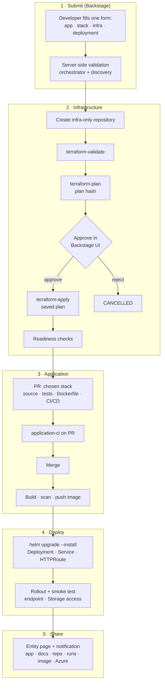
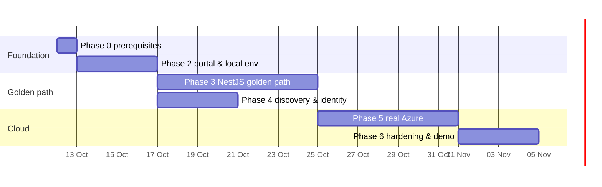

# Implementation plan

The proposed workflow, CI/CD design and phased delivery plan for milestone 1 of Sportify Azure Backstage: **a developer requests a secure NestJS API in Backstage and receives a running application on AKS, with its URLs.**

| Document | Purpose |
|---|---|
| [README.md](README.md) | Project overview and architecture |
| [docs/developer-guide/golden-path.md](docs/developer-guide/golden-path.md) | Step-by-step golden path from the developer's point of view |
| [COMPATIBILITY.md](COMPATIBILITY.md) | Component versions, constraints and risks |
| [docs/adr/](docs/adr/) | Architecture decisions |
| [docs/architecture/microservices.md](docs/architecture/microservices.md) | Service boundaries, communication, deployment, resilience |
| [docs/security/secret-management.md](docs/security/secret-management.md) | Secrets: inventory, storage, delivery, rotation |
| [docs/operations/cleanup.md](docs/operations/cleanup.md) | Cleanup and teardown |
| [docs/operations/demo-environment.md](docs/operations/demo-environment.md) | First demo on a free Azure subscription |

> **Status:** Phase 1 (design) is complete. Each phase below ends with exit criteria. A phase counts as done only when its exit criteria have been run and their results recorded in the README's *Implementation status* table.

---

## Contents

1. [Scope and assumptions](#1-scope-and-assumptions)
2. [Proposed end-to-end workflow](#2-proposed-end-to-end-workflow)
3. [Proposed CI/CD workflows](#3-proposed-cicd-workflows)
4. [Runtime topology](#4-runtime-topology)
5. [Phased delivery plan](#5-phased-delivery-plan)
6. [Demo script](#6-demo-script)
7. [Risks and assumptions](#7-risks-and-assumptions)
8. [Out of scope for milestone 1](#8-out-of-scope-for-milestone-1)

---

## 1. Scope and assumptions

**In scope:** one golden path (NestJS → AKS, `dev` environment), with **Create new** and **Select existing** implemented for every resource (options the subscription can't support are disabled with the reason) and the HA option. **The first demo uses Select existing on a free Azure subscription** ([demo-environment.md](docs/operations/demo-environment.md)).

**Assumptions:**

| # | Assumption |
|---|---|
| A1 | This is a **model project** that shows the design end to end. It is not a production rollout. |
| A2 | Generated repositories are **public**, in a GitHub organisation you own (for example `sportify-org`). |
| A3 | One **free Azure subscription** is used for the first demo, and you can create role assignments and federated credentials in it. Its limits (30-day credit, vCPU quota, MOSP billing) are handled as described in [demo-environment.md](docs/operations/demo-environment.md). |
| A4 | Development happens on Windows with **WSL2 (Ubuntu)** for Backstage. |
| A5 | The versions are those in [COMPATIBILITY.md](COMPATIBILITY.md), checked on 2026-10-10. |
| A6 | Azure costs are kept low with the sizing in [demo-environment.md](docs/operations/demo-environment.md) (AKS Free tier with one small node pool, ACR Basic, smallest Burstable PostgreSQL, LRS Storage), and everything is torn down after the demo. Costs depend on the subscription and are not hardcoded anywhere. |

---

## 2. Proposed end-to-end workflow

### 2.1 Workflow at a glance

### 2.2 Stage-by-stage specification

| # | Stage | Trigger | Actor / system | Inputs | Outputs | State after | Failure handling |
|---|---|---|---|---|---|---|---|
| 1 | Submit | Developer clicks **Create** | Backstage scaffolder → `sportify:request:submit` | Form values, user identity | Request ID | `REQUESTED` | Form errors shown inline; nothing is created |
| 2 | Validate | Submit received | Orchestrator → discovery `/v1/validate`, policies | Request, allowlists | Validated request | `VALIDATING` | Rejected with reasons; no repository is created |
| 2a | Platform provisioning *(only for a new subscription, AKS cluster or ACR)* | Validation passes | Orchestrator raises a platform-repo PR; `platform-plan.yml` and `platform-apply.yml` behind the `platform` environment reviewers | Platform definition | New shared resource | `PLATFORM_PROVISIONING` | `FAILED` with the PR or run link; the application request doesn't continue |
| 3 | Repository | Validation passes | Scaffolder `fetch:template`, `publish:github`, `catalog:register` | Template and values | Repository URL, catalog entity | `REPOSITORY_CREATED` | Retried idempotently; an existing repository for the same request is reused |
| 4 | Validate infrastructure | Repository recorded | `terraform-validate.yml` | Terraform, Helm chart | Check results | `REPOSITORY_CREATED` | `FAILED` with the failing check and a log link |
| 5 | Plan | Validation passes | `terraform-plan.yml` (provisioning identity) | tfvars, state | Plan artifact, summary, **plan hash** | `INFRASTRUCTURE_PLANNED` | `FAILED`; no changes were made |
| 6 | Approve | Plan ready | Approver in Backstage; orchestrator releases the GitHub protection rule | Plan summary | Decision bound to the plan hash, audit event | `AWAITING_APPROVAL` → `PROVISIONING` or `CANCELLED` | Reject → `CANCELLED`; a new plan requires a new approval |
| 7 | Provision | Approval | `terraform-apply.yml` | Saved plan, hash check | Outputs (identity client ID, namespace) | `INFRASTRUCTURE_READY` | `FAILED` lists the resources created; recovery and cleanup are offered |
| 8 | Generate application | Infrastructure ready | Orchestrator opens a PR from the stack template | Stack and infrastructure outputs | PR with app, Dockerfile, CI/CD and Helm values | `APPLICATION_BUILDING` | PR left open with the failing checks; can be retried |
| 9 | Build | PR merged | `application-ci.yml` on `main` (deployment identity) | Source | Image `acr/…:<sha>`, scan report | `APPLICATION_BUILDING` | `FAILED` with test or scan diagnostics |
| 10 | Deploy | Image pushed | `application-deploy.yml` | Image, Helm values | Release, rollout status | `DEPLOYING` | `FAILED`; Helm rolls back automatically; shared resources are never removed |
| 11 | Verify | Rollout complete | Smoke test through the endpoint | URL | Health and Storage checks | `SUCCEEDED` | `FAILED` with the response details |
| 12 | Share | `SUCCEEDED` | Orchestrator → Backstage notification and entity page | Outputs | URLs (app, docs, health, repo, runs, image, Azure, Backstage) | `SUCCEEDED` | — |

### 2.3 Rules that apply to every stage

- **One transition function.** Every state change goes through it, and illegal transitions are rejected.
- **Idempotency.** Each request has a key, and each step has a dedup key. A repeated webhook or retry has no effect.
- **Separate outcomes.** Repository, infrastructure, build and deployment are reported as separate results. A created repository never counts as success.
- **Audit.** Every transition, approval and workflow run is written to `audit_events`, without secrets.
- **Recovery.** If the orchestrator restarts, the worker resumes in-flight steps. If a webhook is lost, the reconciliation poll picks up the event.

---

## 3. Proposed CI/CD workflows

All workflows pin Actions to SHAs, declare least-privilege `permissions:` at the top, use OIDC for Azure, and never expose credentials to `pull_request` runs from forks.

### 3.1 Platform repository (`sportify-azure-backstage`)

| Workflow | Trigger | Jobs | Permissions / identity | Environment |
|---|---|---|---|---|
| `ci-backstage.yml` | PR, push to `develop`/`main` (paths `packages/`, `plugins/`) | install (Yarn 4.13, Node 24) → `tsc` → lint → unit tests → build | `contents: read` | — |
| `ci-python.yml` | PR, push (paths `services/`) | `uv sync` → ruff → mypy → pytest (unit) → pytest (PostgreSQL integration via Testcontainers) | `contents: read` | — |
| `ci-iac.yml` | PR, push (paths `iac/`, `policies/`, `deploy/charts/`) | `fmt -check` → `validate` → TFLint → `terraform test` (mock providers) → Checkov (waivers are inline `checkov:skip` with reasons) → Conftest unit tests for Rego; platform charts: `helm lint` → render → Conftest → Trivy config | `contents: read` | — |
| `ci-templates.yml` | PR, push (paths `templates/`) | Render the NestJS template with fixture values, then run the generated repository's checks offline: `terraform validate`, `helm lint` and `helm template`, `npm test`, `docker build`, kind install | `contents: read` | — |
| `ci-e2e.yml` | PR to `main`, nightly | Full golden path with **mocked** Azure and GitHub adapters: submit → … → `SUCCEEDED`, plus failure scenarios | `contents: read` | — |
| `release-modules.yml` | Tag `iac/modules/<name>/vX.Y.Z` | Validate and test that module, publish release notes | `contents: write` | — |
| `platform-plan.yml` | PR touching `iac/platform/**` (including orchestrator-raised platform requests), manual dispatch | Per changed stack: static gate (fmt, validate, TFLint, Checkov) → plan with `-lock=false` → Conftest and Checkov on the plan JSON → comment the summary | OIDC: **platform plan identity** (Reader on Azure, Storage Blob Data Reader on the `platform` state container) | `platform-plan` |
| `platform-apply.yml` | Manual dispatch after merge | Static gate → plan → Conftest and Checkov on the plan → apply that saved plan | OIDC: **platform identity** | `platform` (GitHub required reviewers) |
| `images.yml` | Push to `main` | Build, scan and push the images for Backstage, `azure-discovery` and `provisioning-orchestrator` | OIDC: **deployment identity (platform)**, `acrPush` | — |
| `deploy-platform.yml` | After `images.yml`, manual | Helm deploy into the `sportify-platform` namespace, then smoke tests | OIDC: **deployment identity (platform)** | `platform` |
| `codeql.yml` / dependency review | PR, push, weekly | CodeQL (Python, TypeScript, Actions, and the Go, C# and Java starters) and dependency review | `security-events: write` | — |
| `ci-security.yml` | PR, push, weekly | gitleaks over the full history; actionlint and zizmor on workflows; Trivy for lockfile vulnerabilities, secrets and Dockerfile misconfiguration (SARIF to code scanning) | `contents: read`, `security-events: write` | — |

Platform infrastructure is approved through **GitHub environment reviewers**, not Backstage. The portal must not be the only way to approve changes to its own infrastructure.

### 3.2 Generated application repository

> **As implemented (ADR-0005):** these workflows are thin callers of the platform's reusable workflows (`reusable-terraform.yml`, `reusable-application-ci.yml`, `reusable-application-deploy.yml`). The Azure identities trust only those reusable workflows, through the organisation's customised OIDC subject. Environments are `<env>-infra-plan`, `<env>-infra`, `<env>-build` and `<env>`. Deploys use `HELM_DRIVER=configmap`.

| Workflow | Trigger | Jobs | Permissions / identity | Environment | Reports to orchestrator |
|---|---|---|---|---|---|
| `terraform-validate.yml` | PR touching `infra/` or `deploy/`; dispatch | `fmt -check`, `init -backend=false`, `validate`, TFLint, Checkov, `helm lint` and `helm template`, Conftest and Trivy config on the rendered chart, gitleaks | `contents: read` (no Azure) | — | `workflow_run` result |
| `terraform-plan.yml` | Dispatch (orchestrator) | The validate checks as a gate, then `init` (backend), `plan -out`, `show -json` → Conftest and Checkov, summary, **SHA-256 of the plan file**, upload artifact | `contents: read`, `id-token: write`; OIDC **provisioning identity** | `dev-infra-plan` | Summary and hash (signed callback using the job's OIDC token) |
| `terraform-apply.yml` | Dispatch (orchestrator) | Download the plan → **check the hash matches the approved hash** → `apply` → readiness checks → outputs | `contents: read`, `id-token: write`; OIDC **provisioning identity** | `dev-infra` (custom protection rule = approval in Backstage) | Result and non-sensitive outputs |
| `application-ci.yml` | PR; push to `main` | lint → unit and integration tests → CodeQL → gitleaks, Trivy (dependencies, Dockerfile, image) → SBOM → push (only on `main`, as `:<sha>`) → build provenance attestation | PR: `contents: read`. Main: plus `id-token: write`; OIDC **deployment identity** (`AcrPush`) | — | Image tag and scan summary |
| `application-deploy.yml` | `workflow_run` of CI on `main`; dispatch | `kubelogin` → `helm upgrade --install --atomic --wait` → `kubectl rollout status` → smoke test (`/health/ready`, `/v1/orders`) | `id-token: write`; OIDC **deployment identity** (namespace-scoped) | `dev` | Deployment status and endpoint |

**Workflow security controls:**

- The jobs that use Azure identities run only for `workflow_dispatch`, `push` to `main` or `workflow_run`, never for `pull_request` runs from forks.
- Each federated credential's subject is tied to **repository + environment** (for example `repo:sportify-org/orders-api:environment:dev-infra`).
- Scanners run in jobs without Azure credentials ([COMPATIBILITY.md](COMPATIBILITY.md), risk 3).
- `CODEOWNERS` covers `.github/workflows/` and `infra/`, so workflow changes need review by the platform team.
- Logs never print tfvars, plan contents or Terraform outputs marked sensitive.

---

## 4. Runtime topology

| Component | Local development (Phases 2–4) | Cloud demo (Phase 5 onwards) |
|---|---|---|
| Backstage | `yarn dev` in WSL2 | Container in the `sportify-platform` namespace on the shared AKS cluster |
| `azure-discovery` | `uv run fastapi dev`, signed in with `az login` | Container, Workload Identity (**discovery identity**) |
| `provisioning-orchestrator` | API + worker via `uv run` | Containers (API + worker), with the GitHub App key from Key Vault through the CSI driver |
| PostgreSQL 17 | `docker compose` | Azure Database for PostgreSQL flexible server (Burstable), Entra authentication |
| GitHub events | **Polling only**, through the reconciliation loop, because a local machine can't receive webhooks | Webhooks through the shared Gateway, plus polling |
| Azure and GitHub | Mock adapters, or real ones when configured | Real |

Locally, the same code path works without exposing your machine to the internet, because the reconciliation poll replaces webhooks.

---

## 5. Phased delivery plan

Each phase lists **tasks**, **deliverables** and **exit criteria**. Exit criteria are commands or observations that can be checked. Effort estimates assume one engineer working part-time and are rough.

### Phase 0: Accounts and prerequisites *(about 0.5 day)*

**Tasks**

- [ ] Create the GitHub organisation `sportify-org` (or chosen name), with the platform repository public.
- [ ] Register **GitHub App #1, Backstage**: repository creation and contents.
- [ ] Register **GitHub App #2, orchestrator**: Actions, Deployments, Contents, Pull requests, webhooks, and **custom deployment protection rule** support.
- [ ] Confirm the Azure subscription, region allowlist (for example `uksouth`) and that you can create role assignments.
- [ ] Set up WSL2 (Ubuntu) with the tool versions from [COMPATIBILITY.md](COMPATIBILITY.md).
- [ ] **Don't create the free Azure subscription yet.** Its 30-day credit starts at sign-up, and Phases 2–3 need no Azure resources. Create it when Phase 3 is nearly finished (see Phase 4).

**Exit criteria:** `node -v` shows v24, `yarn -v` shows 4.13.0, `python3 --version` shows 3.14.x, `terraform version` shows 1.16.x, `helm version` shows v4.3.x and `az version` is at least 2.86. Both Apps are installed on the organisation.

### Phase 1: Architecture and documentation *(done)*

**Deliverables:** README, ADR-0001 (Python services), ADR-0002 (Terraform structure), ADR-0003 (Gateway API), ADR-0004 (HA option), golden-path guide, microservices architecture, secret management, cleanup runbook, demo environment, compatibility plan, this plan.

**Exit criteria:** documents committed on `develop`. ✅

### Phase 2: Portal and local environment *(about 3–4 days)*

**Tasks**

- [ ] Scaffold Backstage 1.55 with `npx @backstage/create-app`, using the new backend system. Set `engines` and `packageManager` as in COMPATIBILITY.md.
- [ ] Configure PostgreSQL through `docker compose`, GitHub sign-in, the GitHub integration (App #1), the catalog and TechDocs (local builder).
- [ ] Register the platform's own `catalog-info.yaml` with System, Components and Group entities, and seed the teams `team-orders` and `platform-approvers`.
- [ ] Set up the `services/` uv workspace with `azure-discovery` and `provisioning-orchestrator` skeletons: health endpoints, settings, structured logging, Dockerfiles.
- [ ] Create the `sportify-platform-backend` bridge plugin: service-to-service authentication, forwarding with the user's identity, and a stub `sportify:request:submit` action.
- [ ] Add `ci-backstage.yml` and `ci-python.yml`.
- [ ] Secret hygiene from day one: `.gitignore` entries, `.env.example`, a gitleaks pre-commit hook and CI job, GitHub secret scanning with push protection, and `scripts/dev-secrets.sh` fetching the dev GitHub App keys from a dev Key Vault into `~/.config/sportify/`.

**Deliverables:** a running portal, two Python services, and the bridge, all running locally.

**Exit criteria**

- `yarn dev` serves the portal, with GitHub sign-in working.
- `GET /healthz` returns 200 on both services.
- A placeholder template runs end to end, and the stub action reaches the orchestrator (visible in its logs and DB).
- CI is green on `develop`.

### Phase 3: NestJS golden path, repository through deployment *(about 6–8 days)*

**Tasks: orchestrator**

- [ ] State machine, transition function, `requests`, `steps` and `audit_events` tables (Alembic).
- [ ] Worker using `FOR UPDATE SKIP LOCKED`; idempotency keys; reconciliation poller.
- [ ] GitHub adapter (App #2): dispatch workflows, read runs, open and merge PRs, handle protection rules; webhook endpoint with HMAC check.
- [ ] Approval endpoints, plan-hash binding, and the separation-of-duties check.

**Tasks: templates and modules**

- [ ] `templates/applications/nestjs/`: scaffolder template (four form pages), the infrastructure-only skeleton, and the application PR content (stack template).
- [ ] Modules `naming`, `app-identity`, `app-namespace`, `role-assignment`, `storage-account`, each with `terraform test`.
- [ ] Generated `infra/terraform` root using the create-new or select-existing `mode` variables.
- [ ] Helm chart: Deployment, Service, ServiceAccount (Workload Identity), HTTPRoute, and hardened `securityContext`. The `availability.tier` value switches replicas, HPA, PDB and topology spread ([ADR-0004](docs/adr/0004-availability-tier-option.md)).
- [ ] HA option end to end: form field with conditional reason, justification and SLO; `/v1/validate` checks (cluster zones, ZRS in region, justification quality); tfvars tier for tags and storage SKU; HA badge on the approval card; catalog annotations and an audit entry.
- [ ] NestJS app: `/v1/orders` (create, list, get) with validation, `/health/live` and `/health/ready`, Storage access through `DefaultAzureCredential`, and Vitest tests.
- [ ] The five generated workflows from [§3.2](#32-generated-application-repository).
- [ ] Policies: Conftest rules for regions, tags, roles, and preventing changes to unmanaged resources.

**Tasks: Backstage UI**

- [ ] `sportify-platform` frontend plugin: the **Create new / Select existing** picker field, the **Provisioning** entity tab (stage timeline, URLs) and the **Approvals** page.
- [ ] Permission `sportify.request.approve`, and a Backstage notification on approval-needed and on success.

**Deliverables:** the golden path working against **mocked** Azure and GitHub adapters, with the real adapters implemented.

**Exit criteria**

- `ci-templates.yml` renders the template and passes `terraform validate`, `helm lint`, `npm test`, `docker build` and the kind install.
- `ci-e2e.yml` (mocked) reaches `SUCCEEDED`. The failure scenarios (validation reject, plan failure, approval reject, deploy failure) end in the correct state.
- Duplicate submissions and replayed webhooks do not create a second repository and do not apply twice (tests).

### Phase 4: Azure discovery and identity *(about 3–4 days)*

**Tasks**

- [ ] Create the **free Azure subscription** now, as late as possible so the 30-day credit covers Phases 4–6: set budget alerts, register resource providers, and check or raise the regional vCPU quota ([demo-environment.md §5](docs/operations/demo-environment.md#5-preparation-checklist)).
- [ ] Discovery endpoints from the README, using Resource Graph (with skip-token paging), the subscriptions client, and the allowlist filter.
- [ ] Typed errors for permission denied, not found and throttled responses; retries with backoff.
- [ ] `POST /v1/validate` for complete selection sets, used by the orchestrator.
- [ ] `GET /v1/subscriptions/{id}/capabilities`: billing account type (vending), regional vCPU quota, cluster zones. The picker disables unsupported **Create new** options and shows the reason.
- [ ] Picker field connected to the live discovery service through the bridge.
- [ ] Platform stack `10-identities`: the backstage, discovery (`Reader`), orchestrator, platform, platform deployment, provisioning, deployment and vending identities; their federated credentials; the platform Key Vault with per-secret RBAC.

**Exit criteria**

- Mock Azure tests pass for paging, 403, 404, 429 and allowlist filtering.
- With `az login`, the picker lists your real subscription and resource groups, and nothing outside the allowlist.
- A tampered request (an ID that isn't allowlisted) is rejected by `/v1/validate`.

### Phase 5: Real Azure provisioning and deployment *(about 5–7 days)*

**Tasks**

- [ ] Platform stacks: `00-bootstrap` (state storage, then migrate its own state into it), and `20-shared-dev` (AKS 1.36 with OIDC, Workload Identity, the Key Vault secrets provider add-on, managed Gateway API and App Routing Istio via `azapi`, and a zonal user pool where quota allows; ACR; DNS zone; shared Gateway; PostgreSQL flexible server), sized for the free subscription.
- [ ] **Create new** for platform resources: the orchestrator raises platform-repo PRs for a new AKS cluster or ACR (applied behind `platform` reviewers), and the `05-subscriptions` vending stack (tested with mocks; not usable on the free subscription).
- [ ] Deploy the platform to AKS with `images.yml` and `deploy-platform.yml`, and PostgreSQL flexible server.
- [ ] Turn on webhooks through the Gateway, plus GitHub custom deployment protection rules.
- [ ] Secret management: Key Vault (RBAC, purge protection, diagnostics), per-secret role assignments, the CSI secrets provider add-on, `SecretProviderClass` per platform service, Entra authentication to PostgreSQL, and webhook secret dual-acceptance.
- [ ] Run the real golden path for `orders-api`.
- [ ] Recovery: partial-failure reporting, retrying a failed step, the cleanup endpoint and the destroy-plan flow.

**Exit criteria**

- A real request reaches `SUCCEEDED`. `https://orders-api.dev.<domain>/health/ready` returns 200 and reports Storage access through Workload Identity, with no secrets anywhere.
- Re-running `terraform-apply` from the GitHub UI without approval stays blocked.
- An application cleanup removes only the platform-created resources (checked with `az resource list --tag managed-by=sportify-platform`).
- The secret-management verification checklist ([secret-management.md §11](docs/security/secret-management.md#11-verification-exit-criteria-for-phase-5-and-6)) passes, including a GitHub App key rotation without failed dispatches.

### Phase 6: Hardening, tests, documentation and demo *(about 3–4 days)*

**Tasks**

- [ ] Fill coverage gaps. Add the opt-in live Azure test suite (`RUN_LIVE_AZURE_TESTS=1`).
- [ ] Security pass: SHA pins verified against release tags, workflow permission review, `SECURITY.md`, `CONTRIBUTING.md`, `LICENSE`.
- [ ] `docs/security/permissions.md`: the exact roles for each identity. `docs/operations/troubleshooting.md`.
- [ ] Record the demo (screenshots or video in `docs/demo/`), archive the example repository, and tear down Azure resources.
- [ ] Update the README *Implementation status* table with the verified results.

**Exit criteria:** every CI workflow is green; the demo evidence is committed; [§6](#6-demo-script) can be reproduced from the docs alone; nothing is left running in Azure.

### Timeline overview

Phase 4's mocked work can run in parallel with Phase 3, but its live Azure checks wait until the free subscription exists, so that Phases 4–6 fit inside the 30-day credit window. The dates are indicative and are not commitments.

---

## 6. Demo script

1. Sign in to Backstage as a member of `team-orders`.
2. **Create → Secure NestJS REST API.** Fill in the four pages (select existing for the subscription, resource group, AKS cluster and ACR; create new for the namespace; HA = No), then **Create**. Along the way, point out that **Create new subscription** is disabled with the reason "needs EA/MCA billing", and that HA = Yes is rejected because the demo cluster doesn't span two zones.
3. Show the request page: `REPOSITORY_CREATED`, then the plan summary and `AWAITING_APPROVAL`.
4. Try to re-run `terraform-apply` from GitHub. Show that it is blocked.
5. Sign in as a member of `platform-approvers`. **Approvals → Approve**.
6. Watch `PROVISIONING → INFRASTRUCTURE_READY`. Open the generated application PR.
7. Watch `APPLICATION_BUILDING → DEPLOYING → SUCCEEDED`.
8. Open the shared URLs: the app, `/docs`, `/health/ready` (Storage OK), the repository, the workflow runs and the Azure resource group.
9. Show the audit trail: requested by, approved by, plan hash and the run IDs.
10. Run cleanup and show that only the platform-created resources are removed.

---

## 7. Risks and assumptions

| Risk | Likelihood | Impact | Mitigation |
|---|---|---|---|
| Azure costs left running | Medium | Medium | Small SKUs, a teardown runbook, budget alerts on the subscription |
| GitHub custom deployment protection rules behave differently than designed | Low | High | Prototype early in Phase 3 with a test repository; documented fallback in the README |
| App Routing Gateway API limitations | Low | Low | ADR-0003 documents the gaps; Application Gateway for Containers as the upgrade |
| Version drift during the project | Medium | Medium | Re-check [COMPATIBILITY.md](COMPATIBILITY.md) at the start of each phase |
| Supply-chain compromise of CI tools | Low | High | SHA pins, checksum-verified binaries, scanners without credentials |
| Backstage upgrade breaks the bridge plugin | Medium | Low | Thin plugins; monthly upgrade with CI |
| Scope creep (more stacks or environments) | Medium | Medium | Milestone 1 is NestJS + `dev` only, as listed in §8 |
| Free subscription limits: 30-day credit, low vCPU quota | High | Medium | Develop locally with mocks; use Azure only in Phase 5 and the demo; budget alerts; quota request in Phase 0; upgrade to pay-as-you-go only if needed ([demo-environment.md](docs/operations/demo-environment.md)) |

---

## 8. Out of scope for milestone 1

- Stacks other than NestJS (shown as *coming soon* in the form).
- `test` and `prod` environments, multi-approver gates and multi-region.
- Showing subscription vending live: it needs an EA or MCA billing account, which the free demo subscription doesn't have. It is implemented and covered by mocked tests, and the form shows it as disabled with the reason.
- Temporal orchestration (ADR-0001 records it as the upgrade path).
- Private generated repositories (see the README's *Repository visibility* section).
- Production hardening: NetworkPolicies, WAF and rate limiting, private endpoints with self-hosted runners, full observability.
