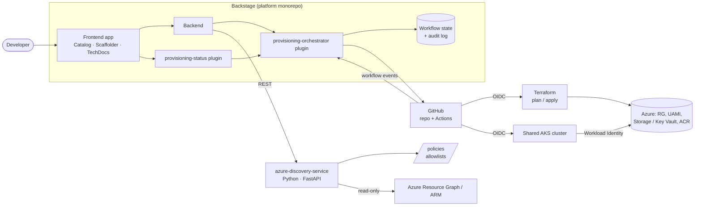
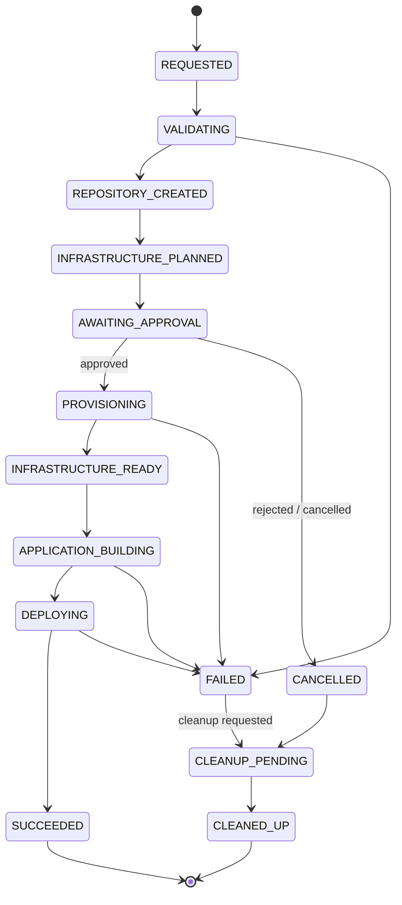

# Sportify Azure Backstage

An Internal Developer Platform (IDP) built on [Backstage](https://backstage.io), Microsoft Azure, Azure Kubernetes Service (AKS), Terraform, Helm and GitHub Actions.

Sportify Azure Backstage lets developers request a production-shaped service through a self-service portal. The platform then validates the request, creates a dedicated repository, provisions or reuses approved Azure infrastructure behind an approval gate, and deploys the application to a shared AKS cluster. Backstage reports the status of each stage.

> **Project status: Phase 1 (architecture and planning).**
> This README describes the target design and the first golden path. Nothing listed under [Features](#features) is implemented yet unless the [Implementation status](#implementation-status) table says so. The table is the source of truth and is updated as each phase is completed and verified.

---

## Contents

- [Why this project](#why-this-project)
- [The first golden path](#the-first-golden-path)
- [Architecture](#architecture)
- [Features](#features)
- [Workflow lifecycle](#workflow-lifecycle)
- [Identity and security model](#identity-and-security-model)
- [Repository layout](#repository-layout)
- [Generated application repository](#generated-application-repository)
- [Prerequisites](#prerequisites)
- [Local development](#local-development)
- [Testing strategy](#testing-strategy)
- [Implementation status](#implementation-status)
- [Roadmap](#roadmap)
- [Documentation](#documentation)
- [Contributing and security](#contributing-and-security)

---

## Why this project

Platform teams often build either a portal with no automation behind it, or a pile of pipelines with no developer-facing interface. This project aims to do both properly for a single use case:

- **Self-service with guardrails.** Developers choose from discovered, allowlisted Azure resources. They never type arbitrary IDs, and the server validates every selection again.
- **Durable, observable workflows.** Long-running Terraform and deployment work runs asynchronously, with persisted state, idempotency, retries and audit events. It never runs inside an HTTP request.
- **Least-privilege identities.** Discovery, provisioning, deployment and application runtime each use a separate identity, federated through OIDC where supported.
- **Honest status.** Repository creation, infrastructure provisioning and application deployment are reported as separate outcomes. A created repository does not count as a successful deployment.

The goal is one complete, enterprise-quality vertical slice rather than many unfinished templates.

## The first golden path

> A developer requests a secure **NestJS REST API** through Backstage. The platform creates a dedicated GitHub repository, provisions or reuses approved Azure infrastructure, and deploys the application to **Azure Kubernetes Service**.

The developer selects:

| Input | Notes |
|---|---|
| Application name and description | Validated against naming rules and checked for duplicates |
| Owner / owning team | Resolved from the Backstage catalog |
| Technology | NestJS (TypeScript) initially; the template architecture is extensible |
| Environment | `dev` initially |
| Azure subscription | **Create new** or **Select existing** |
| Resource group | **Create new** or **Select existing** |
| AKS cluster | **Create new** or **Select existing** |
| Container registry | **Create new** or **Select existing** |
| Kubernetes namespace | **Create new** or **Select existing** namespace owned by the same team |
| Runtime capability | Azure Storage or Key Vault: **Create new** or **Select existing**, accessed through Workload Identity |
| Repository visibility and deployment options | Limited to permitted values |

Sensible defaults let a developer complete the path without filling in every optional field.

### Create new or select existing

For every Azure resource, from the subscription down to the Storage account, the Backstage form shows two options. **Select existing** is the default, because most requests reuse infrastructure that already exists. The first golden path uses **Select existing** throughout.

```
Subscription        ( ) Create new        (•) Select existing
                    [ sub-sportify-dev  ▼ ]   ← populated from azure-discovery-service

Resource group      ( ) Create new        (•) Select existing
                    [ rg-sportify-apps-dev  (uksouth)  ▼ ]

AKS cluster         ( ) Create new        (•) Select existing
                    [ aks-sportify-shared-dev  ▼ ]

Storage account     (•) Create new        ( ) Select existing
                    Name: storordersapidev           [validated as you type]
```

Each selection narrows the next one: the resource groups listed depend on the chosen subscription, and the clusters depend on the chosen resource group or subscription.

| | **Create new** | **Select existing** |
|---|---|---|
| Form input | Name field, pre-filled with a name that follows the naming convention | Dropdown filled from the discovery service. It shows only resources that are allowlisted, in an approved region and visible to the discovery identity |
| Server-side validation | Naming rules, global name availability (e.g. Storage), region and SKU allowlist, quota | The ID is re-resolved through `POST /v1/validate`, confirming it still exists, its type and region are correct, and it is eligible for this team and environment |
| Terraform | Generated as a `resource` block, tagged with owner, environment, application and `managed-by: sportify-platform` | Generated as a `data` block. The platform only adds role assignments and never modifies or destroys the existing resource |
| Plan and approval | Shown as an addition in the plan summary; requires approval before apply | Shown as reuse. Role assignments still appear in the plan and require approval |
| Cleanup on failure or deletion | Can be removed by the controlled cleanup procedure | Never deleted by the platform |

Some resources have stricter rules when **Create new** is chosen:

| Resource | Create new behaviour |
|---|---|
| Subscription | Uses subscription vending through the `Microsoft.Subscription` alias API. It needs an Enterprise Agreement or Microsoft Customer Agreement billing scope, a separate vending identity and platform-team approval. The new subscription is placed under the configured management group. |
| AKS cluster, container registry | Provisioned through the shared platform modules in `iac/`, not the application repository. They require platform-team approval, and the new cluster or registry becomes a shared, reusable target for later requests rather than a one-off for this application. |
| Resource group, namespace, Storage, Key Vault, managed identity | Provisioned from the application repository's Terraform, with the normal plan-and-approve flow. |

Resources created at subscription or cluster level have higher cost and blast radius, so they require an extra approval step and are listed separately in the plan summary.

If discovery returns nothing to select, for example because the identity lacks `Reader` or nothing is allowlisted, the form disables **Select existing** and shows the reason instead of an empty dropdown.

## Architecture



### Components

| Component | Responsibility |
|---|---|
| **Software Catalog** | Ownership, metadata and discovery of services, including generated applications |
| **Scaffolder + Software Templates** | Self-service request form and repository generation |
| **`azure-discovery-service`** (Python, FastAPI) | Standalone, read-only REST service. It lists the existing subscriptions visible to the discovery identity (the same ones shown in the Azure portal), then their resource groups, AKS clusters, registries and data services, using ARM and Azure Resource Graph. Results are filtered against the policy allowlists before they are returned |
| **`azure-discovery-backend` plugin** | Thin Backstage backend module that calls the discovery service on the server side. It backs the scaffolder's dynamic dropdowns and lets the orchestrator re-validate submitted selections. The browser never calls the discovery service directly |
| **`provisioning-orchestrator` plugin** | Durable asynchronous workflow engine: validation, policy, GitHub orchestration, approvals, retries and audit |
| **`provisioning-status` plugin** | Shows stage progress, approvals, plan summaries, deployment state, health and failure diagnostics on the entity page |
| **Policies** | Allowlists for subscriptions, regions, environments, clusters, resource types and operations, enforced on the server |
| **TechDocs** | Architecture, onboarding, service and operations documentation |
| **GitHub integration** | Repository creation, workflow dispatch, environment approvals and run status |

The platform uses Backstage's new backend system and its extension points wherever they apply. Business logic lives in backend plugins, not in frontend components. Built-in capabilities are preferred over custom plugins when they meet the requirement.

### Azure discovery service

Discovery runs as a separate Python service so it can use the official Azure SDKs for Python (`azure-identity`, `azure-mgmt-resource`, `azure-mgmt-resourcegraph`). It can also be developed, tested and deployed independently of the Backstage release cycle.

Planned endpoints (all read-only):

| Method | Path | Returns |
|---|---|---|
| `GET` | `/healthz` | Liveness |
| `GET` | `/readyz` | Readiness, including whether an Azure credential can be acquired |
| `GET` | `/v1/subscriptions` | Enabled subscriptions visible to the discovery identity, filtered by the allowlist |
| `GET` | `/v1/subscriptions/{id}/resource-groups` | Allowlisted resource groups in an approved region |
| `GET` | `/v1/subscriptions/{id}/aks-clusters` | Approved shared AKS clusters, including whether Workload Identity and the OIDC issuer are enabled |
| `GET` | `/v1/subscriptions/{id}/container-registries` | Approved container registries |
| `GET` | `/v1/subscriptions/{id}/resources?type=…` | Allowlisted Storage accounts and Key Vaults available for reuse |
| `POST` | `/v1/validate` | Server-side eligibility check for a full selection set, used by the orchestrator |

Design rules:

- Authentication uses `DefaultAzureCredential`: Workload Identity on AKS, and `az login` or environment credentials for local development. No client secrets are stored in the repository.
- The identity has only the `Reader` role. The service never calls write operations.
- Resource Graph results are paginated using skip tokens. Throttling (`429`) and transient errors are retried with backoff. Permission errors and missing resources produce typed error responses, never empty success responses.
- Only Backstage's backend calls the service, using service-to-service authentication. Discovery results are suggestions only: the orchestrator re-validates every submitted ID through `/v1/validate` before acting on it.

**Microsoft Graph** is used only for supported Microsoft Entra operations. It does not provision Azure infrastructure; Terraform does.

### Infrastructure lifecycles

- **Shared platform infrastructure** (AKS cluster, container registry, Terraform state storage, platform identities) has its own lifecycle and is managed under `iac/`.
- **Application infrastructure** (namespace, user-assigned managed identity, federated credential, Storage account or Key Vault, role assignments) lives in each application's repository.
- When a request chooses **Create new** for an AKS cluster or registry, the new resource is built through the shared platform lifecycle and becomes reusable. It is never a single-application cluster. The platform never destroys shared resources automatically when an application deployment fails.

## Features

The target feature set for the first milestone:

- Backstage portal with catalog, scaffolder, TechDocs and GitHub integration
- NestJS golden-path template with a real sample business endpoint, validation, health endpoints and tests
- **Create new** or **Select existing** for every Azure resource (subscription, resource group, AKS, ACR, namespace, Storage/Key Vault), with dynamic, server-validated selections
- Durable workflow with explicit states, persistence, restart recovery, idempotency and duplicate detection
- Terraform plan, security and policy checks, and plan review before apply
- Approval gates on infrastructure apply and deployment through GitHub Environments
- Container build, tests, dependency and image vulnerability scanning, and push to an approved registry
- Hardened Helm deployment to a shared AKS namespace
- Microsoft Entra Workload Identity for credential-free access to Azure Storage or Key Vault
- Per-stage status, workflow history and actionable diagnostics in Backstage
- Audit events covering who requested, who approved, what changed and which workflow ran

## Workflow lifecycle

The orchestrator models each request as a persisted state machine:



| Stage | What happens |
|---|---|
| 1. Validate | Name, owner, environment, subscription, cluster, permissions and allowlisted selections are checked on the server |
| 2. Discover | The Python discovery service uses Azure Resource Graph and ARM to confirm each resource's existence, type, region and eligibility, using a read-only identity |
| 3. Repository | One GitHub repository is created per request, containing the application, Terraform, Helm, workflows, catalog metadata and docs |
| 4. Validate infra | `terraform fmt`/`init`/`validate`, security scanning, policy checks and Helm linting run; the plan is retained and summarised |
| 5. Provision | After approval, the plan is applied and resource readiness and identity configuration are verified |
| 6. Build | Tests run, the image is built, dependencies and the image are scanned, and the image is pushed to the approved registry |
| 7. Deploy | Helm deploys to the approved namespace, then rollout and health are verified |
| 8. Secure access | The application reaches Storage or Key Vault through a user-assigned managed identity and Workload Identity |
| 9. Register and report | The application appears in the catalog with its repository, environment, provisioning, deployment, health and history |

Durability guarantees:

- State and execution metadata are persisted, and in-flight workflows resume after a Backstage restart.
- Idempotency keys prevent duplicate repositories, and repeated callbacks are ignored.
- An approved plan is applied at most once.
- A failed deployment can never be marked as succeeded.
- Partial failures report which resources were created and point to a controlled recovery or cleanup procedure.
- Secrets, tokens and sensitive Terraform output are never written to logs or the audit trail.

## Identity and security model

| Identity | Scope | Auth |
|---|---|---|
| **Discovery** (used by `azure-discovery-service`) | Read-only (`Reader`) on approved subscriptions | Workload Identity on AKS, `az login` locally |
| **Subscription vending** (only when a new subscription is requested) | Subscription creator on the billing scope, and management group placement | GitHub OIDC federated credential, used by a platform-team-approved workflow |
| **Terraform provisioning** | Narrowly scoped to approved resource groups and role-assignment conditions | GitHub OIDC federated credential |
| **Deployment** | Push to the approved ACR and deploy to the application's namespace only | GitHub OIDC federated credential |
| **Application runtime** | User-assigned managed identity with access only to its own Storage account or Key Vault | Microsoft Entra Workload Identity |

Security principles:

- No single administrator identity is used for all operations.
- OIDC federation is preferred over long-lived client secrets.
- Credentials, certificates, Terraform state, sensitive plans, kubeconfig files and application secrets are never committed.
- Terraform state is stored in an Azure Storage backend with RBAC, versioning, soft delete and blob-lease locking. Local state is used only for isolated tests.
- GitHub Actions are pinned to reviewed commit SHAs and use least-privilege `permissions:`. Protected environments gate apply and deploy.
- Untrusted pull request code never runs with privileged credentials.
- The platform never runs user-supplied Terraform, shell scripts or pipeline definitions.
- Containers run as non-root with a read-only root filesystem where possible, drop all capabilities, use the `RuntimeDefault` seccomp profile, and set resource requests and limits.

Full details will be documented in `docs/security/`, including the exact role assignments for each identity.

## Repository layout

The planned platform monorepo layout, adapted to Backstage conventions:

```
sportify-azure-backstage/
├── packages/
│   ├── app/                         # Backstage frontend
│   └── backend/                     # Backstage backend (new backend system)
├── plugins/
│   ├── azure-discovery-backend/     # calls azure-discovery-service
│   ├── provisioning-orchestrator-backend/
│   └── provisioning-status/         # frontend entity card / page
├── services/
│   └── azure-discovery/             # Python FastAPI discovery service
│       ├── app/                     # routers, Azure clients, policy filter
│       ├── tests/                   # pytest with mocked Azure SDK
│       ├── pyproject.toml
│       └── Dockerfile
├── templates/
│   └── applications/
│       └── nestjs/                  # golden-path software template
├── iac/
│   ├── modules/                     # reusable Terraform modules
│   └── examples/                    # shared platform infra (AKS, ACR, state)
├── policies/                        # allowlists and policy-as-code
├── docs/
│   ├── architecture/
│   ├── adr/
│   ├── developer-guide/
│   ├── security/
│   └── operations/
├── scripts/
├── .github/workflows/
├── README.md
├── CONTRIBUTING.md
├── SECURITY.md
└── LICENSE
```

Generated application repositories are always separate from this platform repository.

## Generated application repository

Each request produces one self-contained repository that the application team owns:

```
<application-name>/
├── src/                     # NestJS app: REST endpoints, config, validation, health
├── test/                    # unit + integration test structure
├── infra/terraform/
│   ├── modules/
│   ├── environments/dev/
│   ├── main.tf  variables.tf  outputs.tf  providers.tf  versions.tf
├── deploy/helm/application/
│   ├── Chart.yaml  values.yaml  values-dev.yaml
│   └── templates/           # Deployment, Service, ServiceAccount, optional HPA/Ingress
├── .github/workflows/
│   ├── terraform-validate.yml
│   ├── terraform-plan.yml
│   ├── terraform-apply.yml
│   ├── application-ci.yml
│   └── application-deploy.yml
├── Dockerfile
├── catalog-info.yaml
├── docs/
└── README.md
```

Application code and infrastructure live in the same repository. The infrastructure definitions and workflows are generated before any provisioning runs.

## Prerequisites

These are the planned prerequisites. Exact pinned versions will be recorded in `docs/adr/` once each phase is implemented.

**Local development**

- Node.js (an Active LTS release supported by the chosen Backstage version) and Yarn
- Python 3.12+ and [uv](https://docs.astral.sh/uv/) for the discovery service
- Azure CLI (`az login`) for running discovery locally against real subscriptions
- Docker
- Terraform, TFLint and a Terraform security scanner (e.g. Trivy or Checkov)
- Helm and kubectl
- A local Kubernetes cluster (kind or k3d) for chart testing

**Live Azure and GitHub execution**

- An Azure subscription with permission to create role assignments and federated credentials
- A shared AKS cluster with the OIDC issuer and Workload Identity enabled
- An Azure Container Registry
- An Azure Storage account for Terraform state
- A GitHub organisation, plus a GitHub App for Backstage with scoped repository permissions
- Microsoft Entra app registrations or managed identities for each identity in the [identity model](#identity-and-security-model)

## Local development

> The commands below describe the intended developer experience and will work once Phase 2 is complete.

```bash
# install dependencies
yarn install

# start Backstage (frontend + backend) with mocked Azure/GitHub adapters
yarn dev

# start the discovery service (in a second terminal)
cd services/azure-discovery
uv sync
uv run fastapi dev app/main.py        # http://localhost:8000/docs

# run all tests
yarn test:all
(cd services/azure-discovery && uv run pytest)

# lint and type-check
yarn lint:all && yarn tsc
```

Mock adapters are only for local development and isolated tests. Live integrations are real code paths, enabled through configuration in `app-config.local.yaml`, which is never committed.

## Testing strategy

| Level | Coverage |
|---|---|
| Unit | Request validation, policy decisions, state transitions, error handling |
| Backend integration | Backstage APIs and the orchestrator against a real database |
| Discovery service | pytest + FastAPI `TestClient` with a mocked Azure SDK: pagination, permission errors, missing resources, throttling, allowlist filtering |
| Infrastructure | `terraform fmt -check`, `init`, `validate`, security scanning, policy tests |
| Helm | `helm lint`, template rendering, schema validation, kind-based install test |
| Application | NestJS unit tests, health checks, container build test |
| End to end | Complete golden path with mocked Azure and GitHub |
| Resilience | Retry safety, duplicate requests, interrupted workflows, unauthorized selections, failed deployments |
| Live (opt-in) | Real Azure integration tests, run only when explicitly configured |

## Implementation status

| Phase | Scope | Status |
|---|---|---|
| 1 | Repository inspection, gap analysis, architecture documentation | 🟡 In progress |
| 2 | Backstage portal, catalog, scaffolder, local dev environment | ⚪ Not started |
| 3 | NestJS golden path: repository generation, Terraform validation, workflow execution, Helm deploy, status reporting | ⚪ Not started |
| 4 | Azure discovery service (Python FastAPI) and secure identity integration | ⚪ Not started |
| 5 | Real Azure provisioning, approvals, state management, failure recovery, cleanup | ⚪ Not started |
| 6 | Full automated testing, security checks, documentation, reproducible demo | ⚪ Not started |

### Definition of done for milestone 1

The first milestone is complete when a developer can:

1. Start the workflow in Backstage.
2. Receive a dedicated GitHub repository containing the application and infrastructure code.
3. Validate and approve the infrastructure plan.
4. Provision or reuse the configured infrastructure.
5. Deploy the application to AKS.
6. Reach the application at its configured endpoint.
7. See accurate status for each stage in Backstage.

## Roadmap

After the NestJS golden path works reliably:

- More application templates (Next.js, Python, .NET, Go, Java) on the same extensible template architecture
- Additional environments (test, prod) with stricter approvals
- NetworkPolicies, ingress hardening, observability (OpenTelemetry, Azure Monitor) and environment-specific controls
- Cost estimation integration, with configurable pricing assumptions and no hardcoded "free tier" claims

Installing a Helm chart successfully does not make it production-ready. Remaining production requirements will be tracked in `docs/operations/production-readiness.md`.

## Documentation

Planned documentation, published through TechDocs:

- `docs/architecture/`: context, data flow, trust boundaries, failure recovery
- `docs/adr/`: Architecture Decision Records
- `docs/security/`: identity boundaries and the exact Azure and GitHub permissions per identity
- `docs/developer-guide/`: using the golden path
- `docs/operations/`: troubleshooting, cleanup and recovery procedures

## Contributing and security

- Contribution guidelines will be in `CONTRIBUTING.md`.
- Please report vulnerabilities privately as described in `SECURITY.md`. Do not open public issues for security problems.

## License

A license will be added in `LICENSE` before the first public release.
