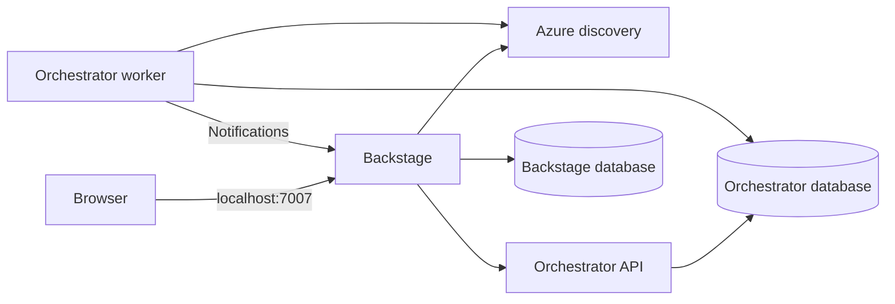

# Local container platform

The platform has three service boundaries and four long-running application processes:

| Process | Image / Dockerfile | Owns | Reachability |
|---|---|---|---|
| Backstage | `sportify/backstage:local`, [`portal/Dockerfile`](../../portal/Dockerfile) | Portal UI, catalog, auth, scaffolder, bridge | Browser: `http://localhost:7007` |
| Azure discovery | `sportify/azure-discovery:local`, [`Dockerfile`](../../services/azure-discovery/Dockerfile) | Read-only inventory and selection validation | Compose network, port 8001 |
| Orchestrator API | `sportify/provisioning-orchestrator:local`, [`Dockerfile`](../../services/provisioning-orchestrator/Dockerfile) | Requests, approvals, callbacks | Compose network, port 8002 |
| Orchestrator worker | Same orchestrator image; command `orchestrator-worker` | Durable jobs, GitHub interaction, notification outbox | Compose network; no listening port |

PostgreSQL has separate `backstage` and `orchestrator` databases and login roles. The one-shot
`orchestrator-migrate` container upgrades the schema before the API starts. Backstage manages its
own plugin schemas. The worker starts after the API and Backstage readiness checks succeed.



## Run later

Docker Engine or Docker Desktop with Linux containers and Docker Compose v2 is required.
These commands are provided for later execution; the container builds and startup have not been
run during implementation.

From the repository root:

```bash
docker compose -f deploy/local/docker-compose.yml up --build -d
docker compose -f deploy/local/docker-compose.yml ps
docker compose -f deploy/local/docker-compose.yml logs -f backstage orchestrator-api orchestrator-worker
```

Open `http://localhost:7007`. No `.env` file is required for the defaults. To adjust the local
token, organization or PostgreSQL administrator password, copy `.env.example` to `.env` inside
`deploy/local/`. Application database passwords remain the throwaway values in `postgres-init.sql`.
Changing a password in an environment variable does not rotate a role in an existing database volume.

The local portal signs in as catalog user `alex`, a member of `team-orders`. Guest authentication
requires both `SPORTIFY_LOCAL_GUEST_AUTH=true` and `app-config.docker.yaml`. The normal image command
loads the production config, where GitHub sign-in and Entra service authentication are used.
Only Backstage and PostgreSQL are published to host loopback; Python APIs remain inside the network.

Azure discovery and the orchestrator use mock integrations. The catalog, resource selectors and
platform APIs can be explored locally; the scaffolder's built-in GitHub publishing/environment
actions still require real GitHub App configuration. This stack does not simulate GitHub Actions,
Terraform apply or AKS deployment, and cannot complete a live golden path without those integrations.
The guest developer cannot approve their own request.

`webhook-secret.dev` is a public, throwaway local placeholder mounted as a file. Real credentials
belong outside the repository or in the ignored `deploy/local/secrets/` directory. Do not reuse
the local guest, static-token or webhook settings for a hosted deployment.

## Images and lifecycle

Build any image independently from the repository root:

```bash
docker build -f portal/Dockerfile -t sportify/backstage:local .
docker build -f services/azure-discovery/Dockerfile -t sportify/azure-discovery:local .
docker build -f services/provisioning-orchestrator/Dockerfile -t sportify/provisioning-orchestrator:local .
```

The Backstage Dockerfile builds the backend/frontend bundle inside the build stage and installs
production dependencies into the runtime bundle. Python images install their selected workspace
package into `/opt/venv`; the path stays the same in build and runtime stages so command shebangs
remain valid. API images include readiness health checks. The worker and migration job disable
the shared image's API health check because neither starts an HTTP server.

Containers run as non-root with read-only roots, writable temporary directories and dropped Linux
capabilities. PostgreSQL persists to `pgdata`. Stop the stack with `docker compose -f
deploy/local/docker-compose.yml down`; this retains database data. Delete volumes only when you
explicitly intend to reset local data. Init SQL runs only when PostgreSQL initializes an empty volume.

Lockfiles are still pending. Builds enforce existing lockfiles and resolve dependencies only when
a lockfile is absent; an invalid existing lockfile fails instead of silently falling back. Commit
validated lockfiles and pin base images by digest before a release.

AKS deployment continues to use the existing [Helm charts](../charts/) and
[microservices architecture](../../docs/architecture/microservices.md). The release workflow now
builds the same Dockerfiles as Compose. Publishing and deployment remain separate actions.
