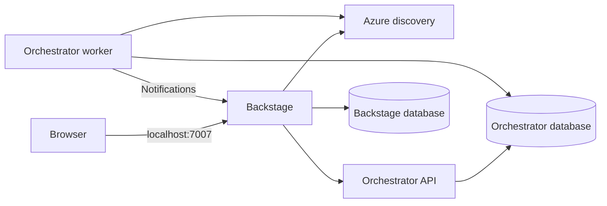

# Local container platform

The platform has three service boundaries and four long-running application processes:

| Process | Image / Dockerfile | Owns | Reachability |
|---|---|---|---|
| Backstage | `sportify/backstage:local`, [`portal/Dockerfile`](../../portal/Dockerfile) | Portal UI, catalog, auth, scaffolder, bridge | Browser: `http://localhost:7007` |
| Azure discovery | `sportify/azure-discovery:local`, [`Dockerfile`](../../services/azure-discovery/Dockerfile) | Read-only inventory and selection validation | Compose network, port 8001 |
| Orchestrator API | `sportify/provisioning-orchestrator:local`, [`Dockerfile`](../../services/provisioning-orchestrator/Dockerfile) | Requests, approvals, callbacks | Compose network, port 8002 |
| Orchestrator worker | Same orchestrator image; command `orchestrator-worker` | Durable jobs, GitHub interaction, notification outbox | Compose network; no listening port |

PostgreSQL has separate `backstage` and `orchestrator` databases and login roles. The one-shot
`orchestrator-migrate` container upgrades the schema before the API starts. Backstage manages its
own plugin schemas. The worker starts after the API and Backstage readiness checks succeed.



## Run it (Windows 11 + WSL2 Ubuntu, Docker Engine)

The platform runs in Ubuntu (WSL2) with Docker Engine; Docker Desktop isn't needed. It is
independent of other projects in the same Ubuntu: it uses only Docker Engine, its own Compose
project (`sportify-platform`), volumes and host ports (7007, 5432), and never touches k3s.

From Windows (PowerShell, in the repository root):

```powershell
.\scripts\local\platform.ps1 up        # build (first time) and start, wait until healthy
.\scripts\local\platform.ps1 e2e       # golden-path check through the running platform's APIs
.\scripts\local\platform.ps1 status
.\scripts\local\platform.ps1 down      # -StopWsl also shuts Ubuntu down when nothing else runs there
```

Or inside Ubuntu (`wsl -d Ubuntu-26.04`, then `cd /mnt/e/Github/azure-backstage-goldenpath`):

| Command | Does |
|---|---|
| `make up` / `make down` / `make restart` | Start (and wait until healthy) / stop the platform; data stays in the postgres volume |
| `make status`, `make logs S=<service>` | Container health and the Backstage URL; follow logs |
| `make e2e` | Backstage, discovery and orchestrator health, approved resources, then a golden-path request that must validate with the default endpoint host (cancelled afterwards) |
| `make test` | Python lint, types, unit/API and e2e tests in a throwaway `uv` container |
| `make test-integration` | Orchestrator PostgreSQL tests through Testcontainers on this Docker Engine |
| `make portal-test` | Portal `yarn install --immutable`, typecheck, lint and tests on a Linux copy of `portal/` |
| `make images`, `make reset` | Rebuild the images; delete the database volume (asks first) |

Open `http://localhost:7007`. No `.env` file is required for the defaults. To adjust the local
token, organization, resource limits or PostgreSQL administrator password, copy `.env.example` to `.env` inside
`deploy/local/`. Application database passwords remain the throwaway values in `postgres-init.sql`.
Changing a password in an environment variable does not rotate a role in an existing database volume.

The local portal signs in as catalog user `alex`, a member of `team-orders`. Guest authentication
requires both `SPORTIFY_LOCAL_GUEST_AUTH=true` and `app-config.docker.yaml`. The normal image command
loads the production config, where GitHub sign-in and Entra service authentication are used.
Only Backstage and PostgreSQL are published to host loopback; Python APIs remain inside the network.

Azure discovery and the orchestrator use mock integrations. The catalog, resource selectors and
platform APIs can be explored locally; the scaffolder's built-in GitHub publishing/environment
actions still require real GitHub App configuration. This stack does not simulate GitHub Actions,
Terraform apply or AKS deployment, and cannot complete a live golden path without those integrations.
The guest developer cannot approve their own request.

`webhook-secret.dev` is a public, throwaway local placeholder mounted as a file. Real credentials
belong outside the repository or in the ignored `deploy/local/secrets/` directory. Do not reuse
the local guest, static-token or webhook settings for a hosted deployment.

## Images and lifecycle

Build any image independently from the repository root:

```bash
docker build -f portal/Dockerfile --target runtime-lite -t sportify/backstage:local .
docker build -f services/azure-discovery/Dockerfile -t sportify/azure-discovery:local .
docker build -f services/provisioning-orchestrator/Dockerfile -t sportify/provisioning-orchestrator:local .
```

The Backstage Dockerfile builds the backend/frontend bundle inside the build stage and focuses
production dependencies on the backend workspace. Local Compose selects `runtime-lite`, which
omits Python, MkDocs and platform documentation source. TechDocs is configured to read prebuilt
documentation; it does not generate docs in this mode. A normal build without `--target` produces
the full `runtime` image, used by the release workflow.
No prebuilt documentation is supplied by default; viewing it requires published content in the
configured storage or selection of the optional generation profile below.

Python images install their selected workspace
package into `/opt/venv`; the path stays the same in build and runtime stages so command shebangs
remain valid. API images include readiness health checks. The worker and migration job disable
the shared image's API health check because neither starts an HTTP server.

## Lightweight defaults

| Long-running process | Memory ceiling | CPU ceiling |
|---|---|---|
| Backstage | 768 MiB (512 MiB Node old-space limit) | 1.0 |
| PostgreSQL | 256 MiB | 0.5 |
| Discovery | 256 MiB | 0.5 |
| Orchestrator API | 256 MiB | 0.5 |
| Orchestrator worker | 256 MiB | 0.5 |

The steady-state configured memory ceilings sum to 1,792 MiB; this is not measured consumption or
a Docker host memory requirement. Builds, the temporary migration container, Docker overhead and
filesystem caches require additional memory. These defaults have not been tested under load.
Node's heap limit covers only part of its process memory. Raise budgets in `.env` if later checks
show memory pressure or slow startup.

PostgreSQL uses 32 MiB shared buffers, 2 MiB work memory per operation and 16 MiB maintenance work
memory. The worker polls idle work every five seconds and reconciles every two minutes locally.
Logs rotate at 5 MB with two files per container. Python services use the base FastAPI/Uvicorn
packages, and optional trace exporters load only when an OTLP endpoint is configured.

For on-demand local TechDocs generation, select the full image and matching config together:

```bash
docker compose -f deploy/local/docker-compose.yml -f deploy/local/docker-compose.docs.yml up --build -d
```

This override raises Backstage's ceiling to 1,536 MiB for MkDocs. To return to the lean profile,
stop it using the same two files, then start the base Compose file with `--build` again. Generated
local docs live in temporary storage and are not retained on container recreation. Production Helm
replica counts and resource defaults remain as previously configured.

Containers run as non-root with read-only roots, writable temporary directories and dropped Linux
capabilities. PostgreSQL persists to `pgdata`. Stop the stack with `docker compose -f
deploy/local/docker-compose.yml down`; this retains database data. Delete volumes only when you
explicitly intend to reset local data. Init SQL runs only when PostgreSQL initializes an empty volume.

Lockfiles are still pending. Builds enforce existing lockfiles and resolve dependencies only when
a lockfile is absent; an invalid existing lockfile fails instead of silently falling back. Commit
validated lockfiles and pin base images by digest before a release.

AKS deployment continues to use the existing [Helm charts](../charts/) and
[microservices architecture](../../docs/architecture/microservices.md). The release workflow now
builds the same Dockerfiles as Compose. Publishing and deployment remain separate actions.
