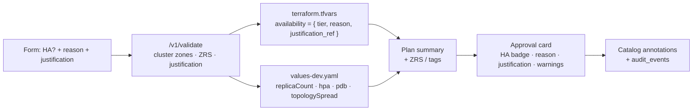

# ADR-0004: High-availability option in the request form

- **Status:** Accepted
- **Date:** 2026-10-10

## Context

Not every application needs high availability (HA). HA costs more: more replicas, zone-redundant storage, and more cluster capacity. It also needs a cluster that can spread pods across zones. If HA were applied to every application, money would be wasted in `dev`. If it were left to each team, critical services might run without it. Developers need a clear choice, and approvers need to know **why** HA was or wasn't chosen.

## Decision

### 1. The form asks "Do you need high availability?"

Page 4 (Deployment) of the Backstage form adds:

| Field | Type | Rules |
|---|---|---|
| **High availability** | Yes / No | Default depends on the environment (see §2) |
| **Reason** | Select: *customer-facing*, *contractual SLA*, *revenue- or safety-critical*, *dependency of a critical service*, *testing HA behaviour*, *other* | Required when the choice differs from the environment default |
| **Justification** | Free text, 30–500 characters | Required when the choice differs from the environment default |
| **Target availability (SLO)** | Select: 99.5 %, 99.9 %, 99.95 % | Shown only when HA = Yes. Informational; recorded in the catalog |

The form explains the trade-off inline: *"HA runs at least 2 replicas across availability zones, with a disruption budget and autoscaling, and uses zone-redundant storage when creating new storage. It increases cost and needs approval."*

### 2. Defaults and policy by environment

| Environment | Default | Choosing the other option |
|---|---|---|
| `dev` | **No** (Standard) | HA = Yes needs a **reason and justification**. It is highlighted on the approval card |
| `test` (future) | No | Same as `dev` |
| `prod` (future) | **Yes** | HA = No needs a **reason and justification**, plus platform-team approval |

The justification is only required when **deviating from the default**. This keeps the common path free of friction and makes every exception explicit.

### 3. What each tier provisions

| Aspect | Standard | High availability |
|---|---|---|
| Replicas | 1 | Minimum **2** (3 in `prod`) |
| Autoscaling (HPA) | Off | On: min 2, max 5, CPU 70 % |
| PodDisruptionBudget | None | `minAvailable: 1` |
| Spreading | — | `topologySpreadConstraints` across `topology.kubernetes.io/zone` (DoNotSchedule) and `kubernetes.io/hostname` (ScheduleAnyway) |
| Rollout | `maxUnavailable: 0`, `maxSurge: 1` (no downtime on deploy) | Same, plus readiness gating on `/health/ready` |
| New Storage account | `Standard_LRS` | `Standard_ZRS` (where the region supports it) |
| Existing Storage or Key Vault | Unchanged | **Unchanged.** Validation adds a *warning* if existing storage is LRS, and the warning is shown to the approver |
| Tags | `availability-tier = standard` | `availability-tier = ha` |
| Catalog annotations | `idp.io/availability-tier: standard` | `…: ha`, plus `idp.io/slo-target` |

### 4. Server-side validation (orchestrator + discovery)

The browser's HA choice is never trusted on its own. `POST /v1/validate` checks:

- **Cluster eligibility.** The selected AKS cluster must have a user node pool spanning **at least 2 availability zones**, with at least 2 nodes, or HA is rejected with that reason. Discovery returns `zones` and `nodeCount` for each node pool.
- **Region support.** If HA creates new storage, ZRS must be allowlisted for the region.
- **Justification present** when the choice deviates from the environment default. Very short or placeholder text (for example `test`, `n/a`, `asdf`) is rejected.
- **Quota and cost.** If a cost estimate is configured, the extra cost of HA is calculated and shown. Nothing is hardcoded.

### 5. How the choice flows through the platform

- **Terraform** receives only the tier and reason, which are used for tags and the storage SKU. The justification text is stored in the orchestrator and the audit log, and the tag holds only a reference (request ID), so free text never ends up in Azure tags.
- **Helm** values are rendered from the tier. The chart has one code path, switched by `availability.tier`.
- **The approval card** shows an **HA badge**, the reason, the justification, the SLO target, warnings (for example, existing LRS storage) and the cost difference if available.
- **The audit trail** records who requested HA, the justification, and who approved it.

### 6. The example request

`orders-api` in `dev` uses **Standard** (the default), so no justification is needed. The golden-path guide shows how the form and the approval card change when HA = Yes is selected.

## Alternatives considered

| Option | Why not |
|---|---|
| HA always on | Wasted cost in `dev` and `test`, and it needs multi-zone clusters everywhere |
| HA always off; teams edit Helm values later | Critical services might run without HA, and there's no record of the decision |
| Free-form replica count in the form | Users could set unsafe values such as 0 or 50, and replica count is only one part of HA (zones, PDB, storage) |
| Justification required for every choice | Friction on the common path. Developers would type filler text |

## Consequences

- Clusters used for HA must have zone-spanning node pools. The `20-shared-dev` stack creates its user node pool across zones 1–3 where the region supports it.
- The Helm chart and the `storage-account` module both take an availability tier input.
- Approvers get an explicit record of why an application is, or is not, highly available.
- Real availability also depends on the dependencies and the region. The SLO target is a stated intent, not a guarantee. Measuring it is part of the observability roadmap.
