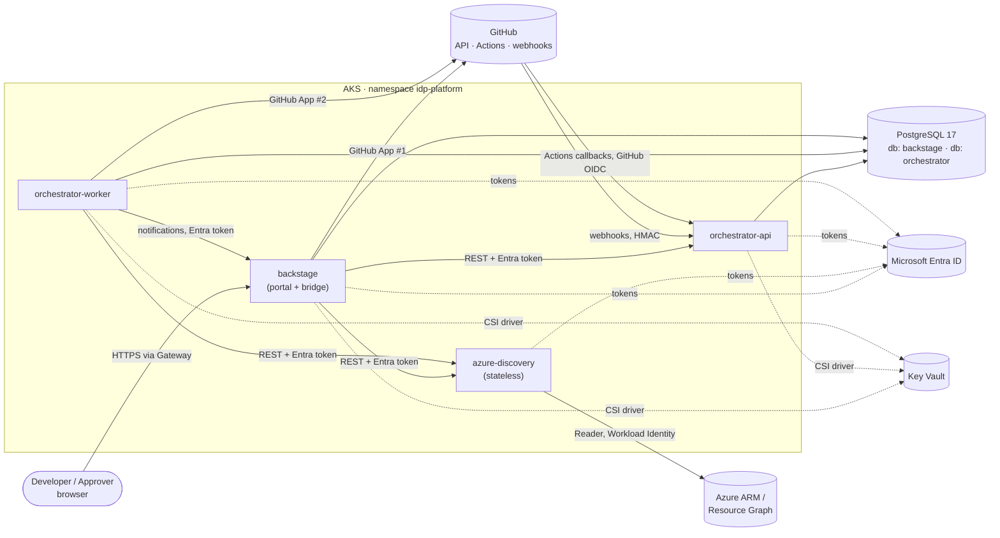
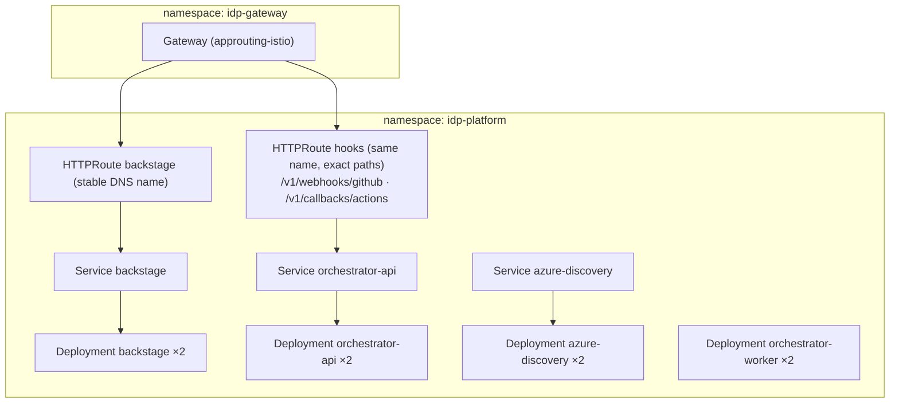

# Platform microservices architecture

How Internal Developer Portal is split into services: what each one owns, how they communicate, how they authenticate to each other, and how they are deployed, scaled and observed.

> **Status:** deployed on AKS (dev) by `platform-release` and verified with the first golden path (v1.0.0). The AKS topology below is what runs. Related documents: [README](../../README.md), [ADR-0001](../adr/0001-python-platform-services.md), [ADR-0006](../adr/0006-container-delivery.md), [local container setup](../../deploy/local/README.md), [COMPATIBILITY.md](../../COMPATIBILITY.md).

---

## 1. Service inventory

| Service | Runtime | Responsibility | State | Deployable units |
|---|---|---|---|---|
| **`backstage`** | Node.js 24, Backstage 1.55 | Developer portal: catalog, scaffolder, TechDocs, sign-in, permissions, notifications. Serves the frontend bundle. Hosts the thin `idp-platform-backend` bridge and the `idp-platform` frontend plugin | PostgreSQL database `backstage` | 1 Deployment |
| **`azure-discovery`** | Python 3.14, FastAPI | Read-only Azure discovery and eligibility validation against the allowlists | **Stateless** (short in-memory cache only) | 1 Deployment |
| **`provisioning-orchestrator`** | Python 3.14, FastAPI | Request lifecycle: validation, state machine, approvals, GitHub orchestration, audit, cleanup | PostgreSQL database `orchestrator` | 2 Deployments from one image: **`-api`** and **`-worker`** |

The supporting infrastructure is not a set of microservices but is shared:

| Component | Used by |
|---|---|
| PostgreSQL 17 (Azure flexible server), with separate databases and roles | `backstage`, `provisioning-orchestrator` |
| Key Vault | `provisioning-orchestrator` (GitHub App key), `backstage` (GitHub App key) |
| AKS, the shared Gateway and the DNS zone | All services |

External systems: **GitHub** (API, Actions, webhooks), **Azure Resource Manager / Resource Graph**, **Microsoft Entra ID**, and **ACR**.

## 2. Context diagram

## 3. Service boundaries

### 3.1 `backstage`

- **Owns:** the catalog entities, scaffolder tasks, user sessions, permission policy, notifications and TechDocs.
- **Exposes:** the portal UI and `/api/*`, including `/api/idp/*` from the bridge plugin.
- **Bridge responsibilities** (no business logic):
  - Translate portal calls into calls to the Python services. Attach a service token, plus user context taken from the **verified** Backstage user token, never from fields in the browser request.
  - Evaluate Backstage permissions (for example `idp.request.approve`) before forwarding a decision.
  - Provide the scaffolder actions `idp:request:submit` and `idp:request:repository-created`.
- **Does not:** call Azure, decide policy, or hold workflow state.

### 3.2 `azure-discovery`

- **Owns:** nothing persistent. It is the read-only view of Azure, filtered through the allowlists in `policies/`.
- **Exposes:** `GET /v1/subscriptions`, `/capabilities`, `/resource-groups`, `/aks-clusters`, `/container-registries` and `/resources`; `POST /v1/validate`; `/healthz` and `/readyz`.
- **Caching:** list endpoints may use a short in-memory cache, for example 60 seconds per subscription, to reduce Resource Graph throttling. **`/v1/validate` never uses the cache**, so validation is always made against live data.
- **Does not:** write to Azure, store anything, or know about requests or workflows.

### 3.3 `provisioning-orchestrator`

- **Owns:** requests, steps, approvals, webhook inbox, notification outbox and audit events (database `orchestrator`).
- **`-api` process:** accepts submissions, status queries, approvals, cancellations and cleanup, GitHub webhooks and Actions callbacks. It **only writes to the database**, so requests stay fast and never wait on GitHub or Azure.
- **`-worker` process:** claims pending steps, calls GitHub and the discovery service, moves state forward, processes the inbox, delivers the outbox and runs the reconciliation poll. For a new subscription, AKS cluster or registry, it raises a pull request in the platform repository and tracks it (`PLATFORM_PROVISIONING`).
- **Why one service with two processes, not two services:** both processes share one data model and one transactional boundary (the state machine). Splitting them would mean sharing a database across services, or adding a message broker, without any benefit.
- **Does not:** hold any Azure write permission. Terraform in GitHub Actions makes every Azure change.

### Data ownership rule

Each database belongs to **exactly one service**. `backstage` and `provisioning-orchestrator` use separate databases with separate login roles on the same server, and **no service reads another service's database**. Data crosses a boundary only through APIs or events.

## 4. Communication

### 4.1 Synchronous calls

| From → To | Protocol | Authentication | Timeout | Retry |
|---|---|---|---|---|
| Browser → `backstage` | HTTPS through the shared Gateway | Backstage session (GitHub sign-in through GitHub App #1) | — | — |
| `backstage` (bridge) → `azure-discovery` | HTTP, ClusterIP | Entra access token from `backstage`'s workload identity, audience = discovery app ID | 5 s | 2 retries, jittered backoff (GET only) |
| `backstage` (bridge) → `orchestrator-api` | HTTP, ClusterIP | Entra token as above, audience = orchestrator app ID | 5 s | POST retries are safe only with an `Idempotency-Key` header, which is always sent |
| `orchestrator-worker` → `azure-discovery` | HTTP, ClusterIP | Entra token from the orchestrator's identity | 10 s | 3 retries, jittered backoff |
| `azure-discovery` → ARM / Resource Graph | HTTPS | Workload Identity, `Reader` | 10 s | Honours `Retry-After` on 429; 3 retries |
| `orchestrator-worker` → GitHub API | HTTPS | GitHub App #2 installation token (short-lived) | 10 s | Honours rate-limit headers; idempotent through step dedup keys |
| `backstage` → GitHub | HTTPS | GitHub App #1 | Backstage defaults | Backstage defaults |
| `orchestrator-worker` → `backstage` notifications | HTTP, ClusterIP | Entra token, accepted by Backstage `externalAccess` (JWKS) | 5 s | Through the outbox until delivered |

APIs are versioned under `/v1`. FastAPI publishes OpenAPI documents, and the bridge's TypeScript client is **generated from them**. Contract tests in CI fail if the OpenAPI document and the client drift apart.

### 4.2 Asynchronous messaging

There is no message broker. The orchestrator uses **PostgreSQL-backed patterns**, which give the guarantees we need without extra infrastructure:

| Pattern | Table | Purpose |
|---|---|---|
| **Job queue** | `steps` | Pending work is claimed with `SELECT … FOR UPDATE SKIP LOCKED`. Each claim carries a lease (`locked_until`), so a crashed worker's job is picked up again after the lease expires. |
| **Inbox** | `inbox_events` | GitHub webhooks and Actions callbacks are stored first, deduplicated by delivery ID, and then processed by the worker. The API acknowledges GitHub quickly, and a replayed event has no effect. |
| **Outbox** | `outbox_messages` | Notifications to Backstage are written **in the same transaction** as the state change, then delivered by the worker with retries. A state change is never lost, and a notification is never sent for a change that didn't commit. |
| **Reconciliation** | — | On a schedule, the worker polls GitHub for runs it is waiting on. This covers lost webhooks, and it is the only mechanism used in local development. |

### 4.3 Inbound from GitHub

| Source | Endpoint | Verification |
|---|---|---|
| GitHub webhooks (`workflow_run`, `deployment_status`, `deployment_protection_rule`, `pull_request`) | `POST /v1/webhooks/github` | HMAC-SHA256 (`X-Hub-Signature-256`) with the App's webhook secret; installation ID allowlist |
| Actions callbacks (plan summary, plan hash, outputs) | `POST /v1/callbacks/actions` | **GitHub OIDC token** from the job: issuer `token.actions.githubusercontent.com`, expected audience, and `repository`/`environment` claims that must match the request's repository and stage |

Only these two paths are exposed publicly, through an `HTTPRoute` with exact path matches. Its host comes from the chart's `dns` values: by default (`auto`) it is read from the Gateway at deploy time, so it is the Gateway's stable Azure DNS name (shared with Backstage) or `platform-hooks.<gateway-ip>.nip.io`. With an own domain it is `platform-hooks.<domain>`. Every other orchestrator endpoint is reachable only inside the cluster.

## 5. Identities and trust boundaries

| Service | Workload identity (Entra) | Azure RBAC | Other credentials |
|---|---|---|---|
| `backstage` | `id-idp-backstage` | None on Azure resources. `Key Vault Secrets User` on its own secrets only (per-secret scope) | GitHub App #1 key and client secret, session secret (Key Vault through CSI) |
| `azure-discovery` | `id-idp-discovery` | `Reader` on the approved subscriptions | — |
| `provisioning-orchestrator` (api + worker) | `id-idp-orchestrator` | None on Azure resources. `Key Vault Secrets User` on its own secrets only (per-secret scope) | GitHub App #2 key and webhook secret (Key Vault through CSI) |
| PostgreSQL logins | Entra authentication mapped to the identities above | Per-database roles | No passwords |

**Trust rules:**

1. The browser is untrusted. Only `backstage` accepts browser traffic.
2. The Python services trust **user context** (user ref, group refs) **only from an authenticated `backstage` caller**. The bridge derives that context from the verified Backstage token.
3. The orchestrator trusts GitHub data only after HMAC or OIDC verification.
4. Discovery output is advisory. The orchestrator re-validates every ID through `/v1/validate` before acting on it.
5. No service has Azure write access. Azure changes happen only through Terraform in GitHub Actions, using the OIDC identities described in the README.

### 5.1 Secrets per service

Most credentials are replaced by Workload Identity and OIDC. The few secrets that remain are kept in Key Vault, granted per secret, and mounted as read-only files through the Secrets Store CSI driver. No Kubernetes `Secret` objects are created. The full design (inventory, rotation, incident response, CI/CD, local development) is in **[secret-management.md](../security/secret-management.md)**.

| Service | Secrets it can read | Everything else |
|---|---|---|
| `backstage` | GitHub App #1 private key and client secret, session secret (and the DB password only if Entra DB authentication can't be used) | Workload Identity |
| `azure-discovery` | **None** | Workload Identity (`Reader`) |
| `provisioning-orchestrator` | GitHub App #2 private key, webhook secret | Workload Identity; Entra DB authentication |
| Generated applications | **None by default**; optional per-app Key Vault | Workload Identity |

## 6. Deployment topology

| Deployment | Replicas | Probes | PodDisruptionBudget | Notes |
|---|---|---|---|---|
| `backstage` | 2 | `/.backstage/health/v1/liveness`, `/.backstage/health/v1/readiness` | minAvailable 1 | Scaffolder tasks are recovered by Backstage after a restart |
| `azure-discovery` | 2 | `/healthz`, `/readyz` (checks that a credential can be acquired) | minAvailable 1 | Stateless; HPA on CPU later |
| `orchestrator-api` | 2 | `/healthz`, `/readyz` (checks the database) | minAvailable 1 | Writes to the database only |
| `orchestrator-worker` | 2 | Liveness from a heartbeat file | minAvailable 1 | Safe to run in parallel thanks to `SKIP LOCKED` and leases; drains on `SIGTERM` (finishes or releases its lease) |

All pods run with the same hardened defaults as generated applications: non-root, read-only root filesystem, all capabilities dropped, the `RuntimeDefault` seccomp profile, and resource requests and limits.

**Network policies** (default deny in `idp-platform`):

| Allow | From → To |
|---|---|
| Ingress | Gateway → `backstage`:7007, Gateway → `orchestrator-api` (webhook and callback paths only) |
| East-west | `backstage` → `azure-discovery`, `backstage` → `orchestrator-api`, `orchestrator-worker` → `azure-discovery`, `orchestrator-worker` → `backstage` (notifications) |
| Egress | All → DNS, Entra ID; `azure-discovery` → ARM; `orchestrator-worker` and `backstage` → GitHub; `backstage`, `orchestrator-*` → PostgreSQL |

**PostgreSQL connectivity:** private access (VNet integration) is preferred. For the model project, a public endpoint with Entra-only authentication and a firewall rule for the AKS egress IP is acceptable, and the README documents it as a model trade-off.

## 7. Resilience

| Concern | Approach |
|---|---|
| Duplicate submissions | `Idempotency-Key` (the scaffolder task ID) with a unique constraint; the existing request is returned |
| Duplicate or out-of-order webhooks | The inbox deduplicates by delivery ID; state transitions accept an event only in the expected state |
| Worker crash during a step | Lease expiry → another worker resumes. Steps are idempotent through dedup keys (for example, "dispatch apply for plan hash X" runs once) |
| GitHub or Azure outage | Retries with backoff and a maximum attempt count, then `FAILED` with diagnostics. The request can be retried manually |
| Lost webhook | The reconciliation poll |
| Backstage down | The orchestrator keeps progressing, the outbox holds notifications, and the status catches up when Backstage returns |
| Orchestrator down | The scaffolder action fails clearly at submit time. In-flight requests resume when the orchestrator returns |
| Discovery down | Pickers show an error state; submissions fail validation (fail closed) |
| Database down | All services report not ready; no partial writes, because state and outbox share a transaction |

## 8. Observability

- **Tracing:** OpenTelemetry in Backstage and both Python services, with W3C `traceparent` passed through every call, configured explicitly (see COMPATIBILITY.md, risk 10). One trace follows a request from the scaffolder to the orchestrator to discovery.
- **Correlation:** every log line and audit event carries the `request_id` and the `trace_id`. GitHub workflow runs receive the `request_id` as a dispatch input, and print it.
- **Logs:** structured JSON to stdout, collected by Container Insights or Azure Monitor when enabled. Secrets and tokens are redacted at the logger level.
- **Metrics:**
  - requests by state
  - step duration and retries
  - approval wait time
  - webhook lag
  - outbox backlog
  - discovery cache hit rate, and 429 responses from ARM
- **Health:** `/healthz` (liveness) and `/readyz` (dependencies) on every service. Backstage shows the platform services' health on the platform System entity.

## 9. Code and repository layout

| Service | Path | Image |
|---|---|---|
| `backstage` | `portal/packages/app`, `portal/packages/backend`, `portal/plugins/idp-platform*` | `acr…/idp/backstage:<sha>` |
| `azure-discovery` | `services/azure-discovery` | `acr…/idp/azure-discovery:<sha>` |
| `provisioning-orchestrator` | `services/provisioning-orchestrator` | `acr…/idp/provisioning-orchestrator:<sha>` (api and worker differ only in the start command) |
| Shared Python code | `services/libs/idp-common` (auth verification, logging, OTel setup) | Packaged into each service by the uv workspace |
| Helm charts | `deploy/charts/{backstage,azure-discovery,provisioning-orchestrator}` | — |

Each service has its own CI path filter, tests, image and Helm release, so it can be built and deployed independently.

### Local container implementation

`deploy/local/docker-compose.yml` defines Backstage, Azure discovery, orchestrator API and worker,
a one-shot Alembic migration job, and PostgreSQL with a persistent volume. All image builds use
the repository root as their context. Backstage serves the bundled UI and backend from port 7007.
Discovery and the orchestrator API are exposed only on the Compose bridge network. PostgreSQL's
host port and the portal bind to loopback.

Startup waits for PostgreSQL readiness, successful migrations, discovery readiness and API readiness.
The worker additionally waits for Backstage, allowing outbox delivery through its static local
external-access token. API health checks are disabled for the worker and migration job, which
do not listen on HTTP. A worker heartbeat remains a follow-up improvement.

The local override explicitly opts into guest sign-in as `alex`, with owning team `team-orders`;
the backend guest module also requires an environment opt-in. Production loads a different config
and keeps GitHub sign-in and Entra authentication. Azure and orchestrator GitHub integrations are
mocked locally, while Backstage's repository publishing actions still require real GitHub credentials.
The local stack is not a complete simulation of Actions, Terraform or AKS.

See [deploy/local/README.md](../../deploy/local/README.md) for build/start commands and pending checks.

The local footprint is bounded by configurable CPU/memory limits and rotated logs. Backstage's
`runtime-lite` image omits Python/MkDocs, and its local TechDocs builder reads prebuilt content.
On-demand generation uses the optional full-image Compose override. The worker's longer local
idle poll and reconcile intervals reduce background database and GitHub activity. Production replica
counts are unchanged; local ceilings are provisional until startup and load measurements are available.

## 10. Why three services, and when to split further

The services follow **responsibility and identity boundaries**, not technical layers:

- **Discovery** is split out because it holds the only Azure read identity, and it has no state.
- **Orchestration** is split out because it owns the workflow state and the GitHub App, and it must keep running when the portal is down.
- **The portal** stays a standard Backstage deployment.

Splitting further now, for example into separate approval, policy, notification and webhook services, would add network calls and either shared databases or a broker, with no independent scaling or ownership need behind it.

**When to split:**

| Signal | Likely split |
|---|---|
| Many more workflow types, or long timers | Move orchestration onto Temporal (ADR-0001), keeping the API service |
| Policy reused outside this workflow | A `policy` service, or OPA as a sidecar |
| Webhook volume much higher than API traffic | A separate `webhook-ingestor` deployment writing to the inbox |
| Several teams owning different workflow parts | Split by team ownership, with a broker (for example Azure Service Bus) replacing the database queue |

## 11. API reference

The services' HTTP APIs, as implemented. The browser never calls them: only the Backstage backend
(and, for discovery, the orchestrator) does.

### 11.1 `provisioning-orchestrator`

The orchestrator is a FastAPI API plus a separate worker process, both sharing one PostgreSQL database:

- **State machine.** Each request is a row with an explicit state (see the README's [Workflow lifecycle](../../README.md#workflow-lifecycle)). Every state change goes through one transition function that rejects illegal transitions.
- **Durable jobs.** The worker claims pending steps with `SELECT ... FOR UPDATE SKIP LOCKED`, so several workers or a restarted worker never process the same step twice. In-flight requests resume after a restart.
- **Idempotency.** Each request has an idempotency key and each step has a deduplication key. A duplicate submission returns the existing request. Repeated webhooks for the same run are ignored.
- **Approvals.** Decisions are made in the Backstage UI and enforced through GitHub custom deployment protection rules (see [Approval in Backstage](../developer-guide/golden-path.md#approval-in-backstage)). The orchestrator holds the request in `AWAITING_APPROVAL` and binds each approval to a plan hash.
- **No Azure write access.** The orchestrator only uses a GitHub App token. All Azure changes are made by Terraform in GitHub Actions using OIDC identities.
- **Audit.** An append-only `audit_events` table records who requested, who approved, which workflow run produced which result and what changed. Secrets and sensitive Terraform output are never stored.

Endpoints:

| Method | Path | Purpose |
|---|---|---|
| `POST` | `/v1/requests` | Submit and validate a request (idempotent) |
| `GET` | `/v1/requests/{id}` | Current state, stage history and diagnostics |
| `POST` | `/v1/requests/{id}/repository` | Record the created repository and start the asynchronous workflow |
| `GET` | `/v1/approvals?status=pending` | Pending approvals visible to the caller |
| `POST` | `/v1/requests/{id}/approval` | Approve or reject the current plan (plan hash, comment) |
| `POST` | `/v1/requests/{id}/cancel` | Cancel a request that has not started applying |
| `GET` | `/v1/requests/{id}/starter` | The stack's starter application for the new repository's first commit |
| `POST` | `/v1/requests/{id}/retry` | Continue a failed request from the step where it stopped |
| `POST` | `/v1/requests/{id}/cleanup` | Start controlled cleanup of resources the platform created |
| `GET` | `/v1/requests/{id}/operations` | What runs now: health, running image and digest, pods and links, read from the cluster (requester, owning team and approvers only) |
| `POST` | `/v1/webhooks/github` | Receive GitHub events (HMAC-verified) |
| `POST` | `/v1/callbacks/actions` | Receive plan summaries, plan hashes and outputs from workflow runs (GitHub OIDC-verified) |
| `GET` | `/healthz`, `/readyz` | Health checks |

### 11.2 `azure-discovery`

Discovery runs as a separate Python service so it can use the official Azure SDKs for Python (`azure-identity`, `azure-mgmt-resource-subscriptions`, `azure-mgmt-resourcegraph`). It can also be developed, tested and deployed independently of the Backstage release cycle.

Endpoints (all read-only):

| Method | Path | Returns |
|---|---|---|
| `GET` | `/healthz` | Liveness |
| `GET` | `/readyz` | Readiness, including whether an Azure credential can be acquired |
| `GET` | `/v1/subscriptions` | Enabled subscriptions visible to the discovery identity, filtered by the allowlist |
| `GET` | `/v1/subscriptions/{id}/capabilities` | Which **Create new** options this subscription supports, with reasons (billing account type for vending, regional vCPU quota, availability zones) |
| `GET` | `/v1/subscriptions/{id}/resource-groups` | Allowlisted resource groups in an approved region |
| `GET` | `/v1/subscriptions/{id}/aks-clusters` | Approved shared AKS clusters, including whether Workload Identity and the OIDC issuer are enabled, and node pool zones and node counts (for HA eligibility) |
| `GET` | `/v1/subscriptions/{id}/container-registries` | Approved container registries |
| `GET` | `/v1/subscriptions/{id}/resources?type=…` | Allowlisted Storage accounts and Key Vaults available for reuse |
| `POST` | `/v1/validate` | Server-side eligibility check for a full selection set, used by the orchestrator |

Design rules:

- Authentication uses `DefaultAzureCredential`: Workload Identity on AKS, and `az login` or environment credentials for local development. No client secrets are stored in the repository.
- The identity has only the `Reader` role. The service never calls write operations.
- Resource Graph results are paginated using skip tokens. Throttling (`429`) and transient errors are retried with backoff. Permission errors and missing resources produce typed error responses, never empty success responses.
- Only the Backstage bridge and the orchestrator call the service, using service-to-service authentication. Discovery results are suggestions only: the orchestrator re-validates every submitted ID through `/v1/validate` before acting on it.

**Microsoft Graph** is used only for supported Microsoft Entra operations. It does not provision Azure infrastructure; Terraform does.
