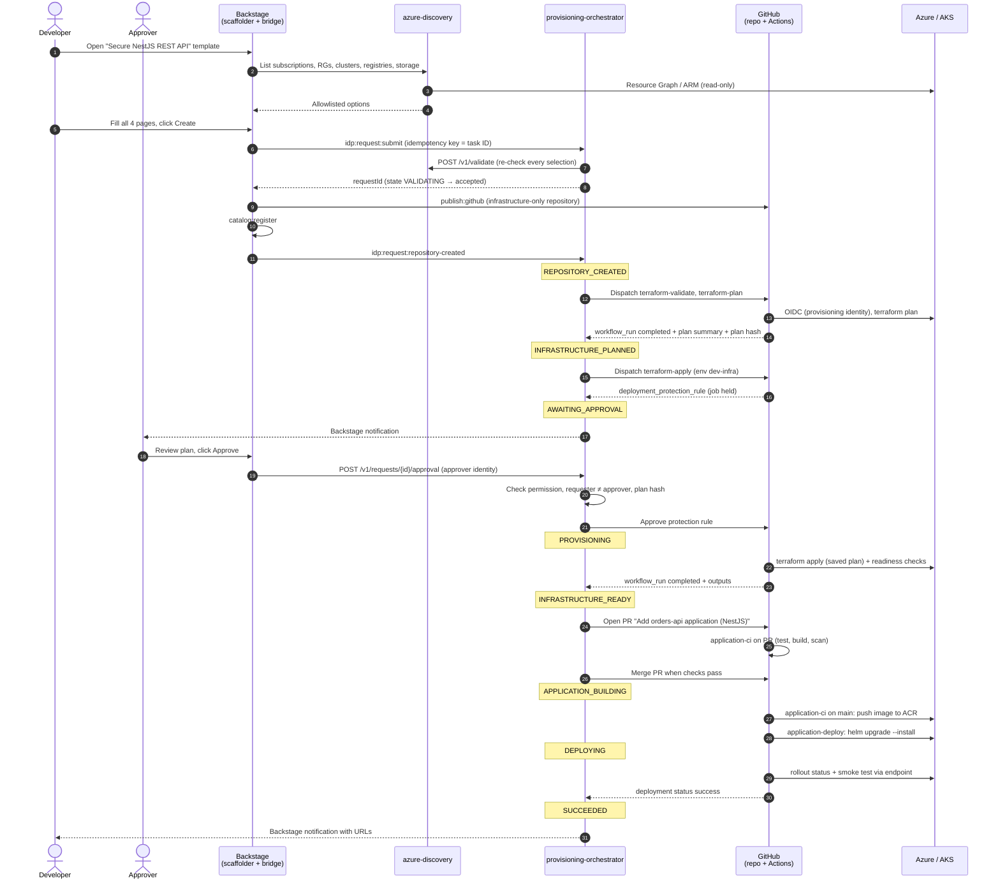

# Golden path: secure NestJS API on AKS

This guide describes the happy path, from submitting a request in Backstage to receiving the URLs of a running application. Read it alongside the [README](../../README.md) and [ADR-0001](../adr/0001-python-platform-services.md).

> **Status:** verified end to end on AKS on 2026-10-17 with `orders-api` (NestJS). See the README's *Implementation status* table.

## Summary

1. **Submit everything in Backstage.** One form collects the application, stack, infrastructure and deployment choices. Nothing runs until the developer clicks **Create**.
2. **Provision infrastructure.** The platform creates the repository with infrastructure code, validates and plans it, waits for **approval in Backstage**, then applies the plan.
3. **Generate the application.** It is generated for the chosen stack, with a rendered Dockerfile, local Compose configuration, checkout instructions and CI/CD, as a pull request into the same repository.
4. **Deploy** to the selected AKS cluster and namespace, then verify the deployment.
5. **Share the URLs** on the Backstage entity page and in a notification.

## Example request

The examples in this guide use the following request.

| Field | Value |
|---|---|
| Application | `orders-api`: "Order management REST API" |
| Owner | `team-orders` |
| Stack | NestJS (TypeScript) |
| Environment | `dev` |
| Tenant | `XY Corp (xycorp.onmicrosoft.com)` |
| Management group | `Landing zones / Corp` (internal application landing zone) |
| Subscription | Select existing: `sub-idp-dev` |
| Resource group | Select existing: `rg-idp-apps-dev` |
| AKS cluster | Select existing: `aks-idp-shared-dev` |
| Container registry | Select existing: `acridpdev` |
| Namespace | Create new: `orders-api` |
| Runtime capability | Storage, select existing: `stidpshareddev` (blob read and write) |
| Endpoint host | `orders-api.dev.xycorp.local` |
| High availability | **No** (the `dev` default, so no justification is needed) |
| Repository visibility | Public |

## Sequence



## High-availability choice

Page 4 asks **"Do you need high availability?"** ([ADR-0004](../adr/0004-availability-tier-option.md)).

```
High availability   ( ) Yes   (•) No          ← default for dev
  ℹ HA runs ≥2 replicas across zones, with a disruption budget and autoscaling, and uses
    zone-redundant storage for new storage. It increases cost and needs approval.

── when "Yes" is selected in dev ──────────────────────────────────────
  Reason         [ Customer-facing                      ▼ ]
  Justification  [ Public checkout API used by the web shop; outages block
                   orders. Needs to survive a zone failure.               ]
  SLO target     [ 99.9 %  ▼ ]
```

| Choice in `dev` | Effect |
|---|---|
| **No** (default) | 1 replica, no HPA or PDB, LRS for new storage. No justification needed |
| **Yes** | ≥2 replicas, HPA 2–5, PDB, zone spreading, ZRS for new storage. **Reason and justification required.** The server checks that the cluster spans at least 2 zones. The approval card shows an HA badge |

## Step 1: Submit everything in Backstage

The template **Create → "Application starter"** asks for as little as possible: two pages, then a review page.
A developer who accepts the defaults types only the application name and picks a team.

| Page | Fields | Source of options |
|---|---|---|
| 1. Your application | **Name** and **owning team** (required); description (optional) | Owner from the Backstage catalog |
| 2. Platform settings | Every field is a **dropdown preselected with the platform default**. Choosing **Custom…** or **Create new…** reveals a text box for your own value | See below |

| Setting | Default | Custom option |
|---|---|---|
| Stack | NestJS; stacks awaiting validation are listed as *coming soon* | Any enabled stack |
| Environment | `dev` | — (only `dev` is enabled) |
| Tenant and management group | The only approved tenant, and the deepest landing zone holding an approved subscription (e.g. *Landing zones / Corp*) | Another approved tenant or group; none can be created here ([ADR-0008](../adr/0008-caf-landing-zone-placement.md)) |
| Subscription, resource group, AKS cluster, container registry, Storage or Key Vault | The first approved resource from `azure-discovery`, filtered by the selection above it (tenant → management group → subscription → resource group → Storage or Key Vault) | **Create new…** with a suggested name; disabled with the reason when the subscription can't support it |
| Kubernetes namespace | The application name | **Custom…** |
| Endpoint host | `<name>.<gateway domain>` of the selected cluster, e.g. `orders-api.dev.xycorp.local` | **Custom…**; outside the gateway domain you own DNS and TLS |
| Availability | Standard: one pod with the stack's minimum resources ([sizing](technology-stacks.md#runtime-sizing)) | High availability, which asks for a reason, justification and SLO target |
| Repository visibility | Public | Private |

The server applies the same defaults if a field arrives empty: discovery derives the endpoint host from
the cluster's `gateway.base_domain` in `policies/allowlist.yaml`.

When the developer clicks **Create**:

- `idp:request:submit` sends the full request to the orchestrator. The scaffolder task ID is the idempotency key, so submitting twice returns the same request.
- The orchestrator validates everything on the server: naming rules, duplicates, team membership, the environment policy, and every Azure ID through `POST /v1/validate`. An invalid request is rejected here, **before** any repository exists.
- The developer is taken to the request's status page.

## Step 2: Provision infrastructure

| # | Action | Actor | State |
|---|---|---|---|
| 2.1 | `publish:github` creates `nixvarghese01/orders-api` containing **infrastructure only**: `infra/terraform`, the Helm chart, the `terraform-*` workflows, `catalog-info.yaml` and docs. Branch protection is applied. `catalog:register` adds it to the catalog | Backstage | `REPOSITORY_CREATED` |
| 2.2 | `terraform-validate.yml`: `fmt -check`, `init`, `validate`, TFLint, security scan, policy checks, `helm lint` and `helm template` | GitHub Actions | `REPOSITORY_CREATED` |
| 2.3 | `terraform-plan.yml` (environment `dev-infra-plan`, no approval): logs in with the provisioning identity through OIDC and saves the plan as an artifact. A summary and the plan hash are sent to the orchestrator | GitHub Actions | `INFRASTRUCTURE_PLANNED` |
| 2.4 | `terraform-apply.yml` is dispatched and **held** by the custom deployment protection rule on the `dev-infra` environment | Orchestrator, GitHub | `AWAITING_APPROVAL` |
| 2.5 | Approval in Backstage (see [Approval in Backstage](#approval-in-backstage)) | Approver | `AWAITING_APPROVAL` |
| 2.6 | Apply the **saved plan**, then check that the managed identity, federated credential and role assignment are ready | GitHub Actions | `PROVISIONING` → `INFRASTRUCTURE_READY` |

The plan for the example request:

```
+ azurerm_user_assigned_identity          id-orders-api-dev
+ azurerm_federated_identity_credential   system:serviceaccount:orders-api:orders-api
+ kubernetes_namespace                    orders-api
+ kubernetes_resource_quota               orders-api/default
+ kubernetes_limit_range                  orders-api/default
+ kubernetes_role_binding                 orders-api/deployer
+ azurerm_role_assignment                 Storage Blob Data Contributor → stidpshareddev
= reused (data sources): sub-idp-dev, rg-idp-apps-dev,
  aks-idp-shared-dev, acridpdev, stidpshareddev
Plan: 7 to add, 0 to change, 0 to destroy.
```

## Approval in Backstage

The approval decision is made in Backstage, and GitHub enforces it.

**What the approver sees.** Members of the approver group, for example `platform-approvers`, receive a Backstage notification linking to **IDP → Approvals**. The approval card shows:

- the requester, application, environment and time
- the plan summary: resources added, changed, destroyed and reused
- the **availability tier**, with an **HA badge**, reason, justification, SLO target and any warnings (for example, existing LRS storage) when HA was requested
- the policy check and security scan results
- the cost estimate, only when a reliable estimate is configured
- links to the full plan and the workflow run
- a comment box and **Approve** / **Reject** buttons

**How the decision is enforced:**

1. The `dev-infra` GitHub Environment has a **custom deployment protection rule** owned by the orchestrator's GitHub App. GitHub holds the apply job and sends a `deployment_protection_rule` webhook to the orchestrator.
2. The approver clicks **Approve**. The Backstage bridge forwards the decision with the approver's identity.
3. The orchestrator checks that:
   - the approver holds the Backstage permission `idp.request.approve` for the environment
   - the approver is **not** the requester (separation of duties). For a single-person demo, an environment can opt out with `ORCHESTRATOR_SELF_APPROVAL_ENVIRONMENTS` (Helm: `config.selfApprovalEnvironments`); `prod` never can, and the approval is recorded as `self_approved`
   - the approval is bound to the **exact plan hash** (a new plan needs a new approval)
   - the request has not already been decided (a duplicate click or replayed request has no effect)
   - enough **distinct** approvers have approved: the environment's `approvers_required` in `policies/allowlist.yaml`, which discovery returns with the validation result. Approvals count only for the exact plan hash, plan run and mode (apply or destroy), so a new plan, a retry or a destroy starts again at zero; the same person approving twice counts once; the requester never counts toward a requirement of two or more. Until enough approvals arrive, the request stays `AWAITING_APPROVAL` and Backstage shows "1 of 2 approvals". A missing or invalid count refuses the decision, and `prod` never accepts fewer than two
4. When the last required approval arrives, the orchestrator approves the protection rule through the GitHub API, and the apply job runs. **Reject** rejects the rule instead: the job fails cleanly, the state becomes `CANCELLED`, and the reason is shown.
5. The decision, approver, comment, plan hash and workflow run ID are written to `audit_events`.

Re-running the workflow from the GitHub UI does not bypass approval, because the job still waits for the orchestrator to release the protection rule.

**Approval gates by environment:**

| Gate | dev | test / prod (future) |
|---|---|---|
| Infrastructure apply | One approver in Backstage | Two distinct approvers in Backstage (enforced by the orchestrator) |
| Application deploy | Automatic | Approval in Backstage |
| New subscription, AKS cluster or container registry | Platform team, through the `platform` GitHub environment reviewers on the platform repository. Backstage shows the status and links but doesn't approve | Same |

## Step 3: Generate the application for the chosen stack

The application is added only **after** the infrastructure is ready. A failed provisioning run therefore never leaves a half-working application, and the Helm values contain real infrastructure outputs.

| # | Action | Actor | State |
|---|---|---|---|
| 3.1 | Open a pull request, "Add orders-api application (NestJS)", generated from the chosen stack's template | Orchestrator (GitHub App) | `APPLICATION_BUILDING` |
| 3.2 | `application-ci.yml` runs on the pull request: lint, unit tests, integration tests, container build and dependency scan | GitHub Actions | `APPLICATION_BUILDING` |
| 3.3 | Merge the pull request once the required checks pass | Orchestrator (GitHub App) | `APPLICATION_BUILDING` |
| 3.4 | `application-ci.yml` runs on `main`: build, image scan, then push `acridpdev.azurecr.io/orders-api:<git-sha>` using the deployment identity (OIDC) | GitHub Actions | `APPLICATION_BUILDING` |

The pull request contains:

- `src/`: NestJS application with the `/v1/orders` sample endpoint (create, list and get), DTO validation, config management, Storage access through `DefaultAzureCredential`, and `/health/live` and `/health/ready`
- `test/`: unit tests plus the integration test structure
- `Dockerfile`: a basic multi-stage build with a small runtime image, a non-root user and no secrets
- `.github/workflows/application-ci.yml` and `application-deploy.yml`, with Actions pinned to commit SHAs and least-privilege `permissions:`
- `deploy/helm/application/values-dev.yaml`, filled in with the identity client ID, namespace, image repository and endpoint host from the infrastructure outputs

## Step 4: Deploy to the selected resources

| # | Action | State |
|---|---|---|
| 4.1 | `application-deploy.yml` (environment `dev`) logs in with the deployment identity, which has namespace-scoped access only | `DEPLOYING` |
| 4.1a | The deployed Helm revision and image are recorded (none on a first install) | `DEPLOYING` |
| 4.2 | `helm upgrade --install --atomic` into the `orders-api` namespace on `aks-idp-shared-dev`, with the Workload Identity labels and annotations | `DEPLOYING` |
| 4.3 | `kubectl rollout status` waits for the new pods | `DEPLOYING` |
| 4.4 | A smoke test through the endpoint checks `/health/ready` (including the Storage dependency) and `GET /v1/orders` | `DEPLOYING` |
| 4.5 | The deployment status is reported as success, with the Helm revision and image tag | `SUCCEEDED` |

**When a check fails.** Helm's `--atomic` undoes only a failed upgrade. Readiness (4.3) and the smoke test (4.4) run after Helm has finished, so a failure there would leave the new release serving. In that case the workflow rolls back to the revision recorded in 4.1a and verifies that the workload runs the previous image again. A first install has nothing to restore, so it stays installed for diagnosis, and **Clean up** removes it. The run still fails, and the request becomes `FAILED`. The callback says which check failed (`deploy`, `readiness` or `smoke`) and what the cluster confirms (`helm_atomic`, `succeeded`, `failed` or `not_possible_first_install`), and the Provisioning tab shows that message. The run's `deploy-diagnostics` artifact holds the Helm history, workload state, events and logs. No rollback is ever claimed without that check (`scripts/ci/app-deploy-recovery.sh`).

The containers run as non-root, with a read-only root filesystem, all capabilities dropped, the `RuntimeDefault` seccomp profile, resource requests and limits, and liveness and readiness probes. No Azure credentials exist in the code, the image, the Helm values or the repository.

## Step 5: Share the URLs

The URLs are shown on the Backstage entity page (`orders-api` → *Overview* and *Provisioning*). They are also sent as a Backstage notification to the requester and the owning team.

| What | URL |
|---|---|
| Application endpoint | `https://orders-api.dev.xycorp.local` |
| API docs (Swagger) | `https://orders-api.dev.xycorp.local/docs` |
| Health | `https://orders-api.dev.xycorp.local/health/ready` |
| Repository | `https://github.com/nixvarghese01/orders-api` |
| Workflow runs | `https://github.com/nixvarghese01/orders-api/actions` |
| Container image | `acridpdev.azurecr.io/orders-api:<git-sha>` |
| Azure resource group | Azure portal link to `rg-idp-apps-dev` |
| Backstage entity | `https://backstage.xycorp.local/catalog/default/component/orders-api` |

Each stage is reported as its own outcome:

```
✅ Request validated
✅ Repository created
✅ Infrastructure provisioned   7 added · 0 changed · 0 destroyed · approved by <approver>
✅ Application built            tests passed · 0 critical vulnerabilities
✅ Deployed                     healthy · 1/1 pods ready (Standard tier)
```

### Operations tab: how the service is doing now

The *Provisioning* tab is history: a request that succeeded yesterday says nothing about today. The **Operations** tab shows what runs **now**, observed in the cluster:

- **Health** from the workload itself, not the last workflow: `healthy`, `degraded` (fewer ready replicas than desired, or a stuck rollout, with the reason such as `CrashLoopBackOff`), `down` (none ready), `stopped` (scaled to zero), `missing` (the Deployment is gone), `not_deployed` or `removed`. Pod readiness uses the application's `/health/ready` probe.
- **Running version:** the image and its digest, the last successful deployment (time, Helm revision, image tag) and a warning when the cluster runs a different image.
- **Pods:** ready, restarts and the current reason.
- **Links:** application, repository, last deployment run, runbook (the TechDocs *Runbook* section), and dashboard, logs and traces. The last three come from the monitoring stack (#107); until it's configured they show *unavailable (not configured)*.
- **Source and age:** when the cluster can't be read (no permission, API unreachable), health is **unknown**, never healthy, and the last observation is kept and marked stale.

Only the requester, the owning team and approvers can see it. The orchestrator reads the cluster with a read-only role (Deployments, ReplicaSets and Pods; no Secrets, ConfigMaps, logs or exec), so the browser never gets cluster or Azure credentials. Each workload is read at most once every 15 seconds (`ORCHESTRATOR_OPERATIONS_CACHE_SECONDS`), however many people have the tab open. Failed reads are cached too, and the tab refreshes every 30 seconds while visible and every 2 minutes after a failure.

### Kubernetes tab: the workload in detail

Each generated service also has a **Kubernetes** tab, the [Backstage Kubernetes plugin](https://backstage.io/docs/features/kubernetes/), which lists the release's pods, deployments, replica sets, services and autoscalers on `aks-idp-shared-dev`, with their status, restarts and errors. The catalog entry finds them through `backstage.io/kubernetes-label-selector: app.kubernetes.io/instance=<app>` and `backstage.io/kubernetes-namespace: <app>`, using labels the Helm chart already sets.

Backstage reads the cluster with its own service account and the read-only `idp-backstage-kubernetes-reader` role (pods, logs, services, events, deployments, replica sets, autoscalers; no Secrets or ConfigMaps). **Pod logs and events** go through the plugin's proxy, which can call any path with those credentials and can't be limited to one service, so the portal's permission policy allows the proxy (`kubernetes.proxy`) only for platform approvers. Everyone signed in sees the workloads. The *Operations* tab stays the per-team summary of health and version.

## Developer checkout

The repository initially contains infrastructure only. After the application's generated pull
request merges, a developer can check out the selected stack's dummy application and run it locally:

```bash
git clone https://github.com/nixvarghese01/orders-api.git
cd orders-api
docker compose up --build -d
```

The NestJS starter exposes Swagger at `http://localhost:3000/docs`, readiness at `/health/ready`
and the sample `/v1/orders` API. Local Compose deliberately uses an in-memory repository with no
Azure credentials; data is lost on restart. The same Dockerfile builds the CI/deployment image,
while deployed Helm values provide the approved Azure runtime configuration. Local startup and
cloud deployment remain separate outcomes.

The orchestrator selects the allowlisted stack and renders it from one stack template: the source,
tests, Dockerfile, Compose file and README go into the repository's first commit (scaffolder action
`idp:request:starter`), so the starter is there from the start; the CI/CD workflows and the Helm values
filled with the infrastructure outputs follow in the application pull request after apply. New technologies need their own
stack template, tests and compatible reusable build/deploy workflow before being enabled. The
current implementation enables NestJS, verified on AKS; the other stacks await their target-system run.

## State timeline

```
REQUESTED → VALIDATING → REPOSITORY_CREATED → INFRASTRUCTURE_PLANNED
→ AWAITING_APPROVAL → PROVISIONING → INFRASTRUCTURE_READY
→ APPLICATION_BUILDING → DEPLOYING → SUCCEEDED
```

Expected duration: about 10–15 minutes of automated work, plus the time taken to approve.

Any state can end in `FAILED`. The Provisioning tab shows where and links the workflow run. Fix the cause,
then **Retry**: it continues from that step. A step the orchestrator itself runs (for example opening the
application pull request) runs again; validation runs again; a failed plan or apply starts from a fresh
plan that needs approval again; a failed application CI or deploy run re-runs its failed jobs. **Clean up**
removes what was created instead.

## Prerequisites for this path

These are set up once by the platform team:

- the shared AKS cluster with the OIDC issuer and Workload Identity enabled, the **App Routing Gateway API** with a shared `Gateway` ([ADR-0003](../adr/0003-ingress-gateway-api.md)), and a **DNS zone** for `*.dev.xycorp.local`
- the shared container registry, the Terraform state storage account, the platform Key Vault (with the AKS Key Vault secrets provider add-on) and PostgreSQL
- for the first demo, a **free Azure subscription** prepared as described in [demo-environment.md](../operations/demo-environment.md)
- the discovery, provisioning and deployment identities with their federated credentials
- a GitHub App for Backstage (repository creation) and a GitHub App for the orchestrator, registered as a **custom deployment protection rule** provider
- generated repositories created as **public**. See [Repository visibility](../../README.md#repository-visibility) for what changes if they are made private.
