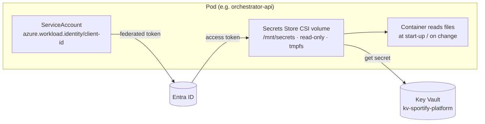

# Secret management

How Sportify Azure Backstage avoids, stores, delivers, rotates and protects secrets, across the platform services, CI/CD, Terraform and the generated applications.

> **Status:** design for milestone 1. Related documents: [microservices architecture](../architecture/microservices.md), [README: identity and security model](../../README.md#identity-and-security-model), [ADR-0002](../adr/0002-terraform-structure.md).

---

## 1. Principles

1. **Eliminate first.** Use identity federation (Microsoft Entra Workload Identity and GitHub OIDC) instead of secrets wherever the platform supports it. A secret that doesn't exist can't leak.
2. **One store.** Every remaining secret lives in **Azure Key Vault**. Secrets are never in Git, container images, Helm values, Terraform variables, GitHub repository secrets or logs.
3. **Least privilege per secret.** Access is granted with Azure RBAC **at the scope of the individual secret**, to the one identity that needs it.
4. **Delivered at runtime.** Pods receive secrets as mounted files through the Secrets Store CSI driver, authenticated by Workload Identity. No secret is baked in at build time.
5. **Rotatable without downtime.** Every secret has an owner, a rotation interval and a tested rotation procedure.
6. **Detect and redact.** Secret scanning runs on commits, pull requests and images, and loggers redact known secret patterns.

## 2. What is not a secret (eliminated by design)

| Need | How it is met without a stored secret |
|---|---|
| GitHub Actions → Azure (plan, apply, push, deploy) | **GitHub OIDC** federated credentials on the provisioning and deployment identities. Subjects are bound to the repository and environment |
| Platform pods → Azure (ARM, Key Vault, PostgreSQL) | **Entra Workload Identity**: the pod's service account is federated to a user-assigned managed identity |
| Generated app → Azure Storage or Key Vault | **Entra Workload Identity** with `DefaultAzureCredential` |
| Service-to-service calls (`backstage` → Python services, worker → `backstage`) | **Entra access tokens** from each service's workload identity, validated by audience and caller allowlist |
| Actions callbacks → orchestrator | **GitHub OIDC token** of the job, validated against its issuer, audience and the repository and environment claims |
| PostgreSQL logins | **Entra authentication**, with tokens from the workload identity (see the note in §3) |
| Terraform state access | **Entra ID only** (`use_azuread_auth`); storage account keys are disabled |
| Pulling images from ACR | The AKS kubelet identity has `AcrPull`, so there is no image pull secret |
| Azure IDs in workflows (`AZURE_CLIENT_ID`, `AZURE_TENANT_ID`, `AZURE_SUBSCRIPTION_ID`) | Stored as GitHub **Actions variables**, not secrets. They are identifiers, not credentials |

## 3. Secret inventory

Only these secrets exist in the platform:

| # | Secret | Used by | Stored in | Delivered as | Rotation | Owner |
|---|---|---|---|---|---|---|
| S1 | GitHub App #1 (Backstage) **private key** | `backstage` | `kv-sportify-platform-<env>` / `gh-app-backstage-key` | CSI file → Backstage config `$file:` | 90 days | Platform team |
| S2 | GitHub App #1 **client secret** (user sign-in) | `backstage` | `…/gh-app-backstage-client-secret` | CSI file | 90 days | Platform team |
| S3 | Backstage **auth session secret** | `backstage` | `…/backstage-session-secret` | CSI file | 180 days | Platform team |
| S4 | GitHub App #2 (orchestrator) **private key** | `provisioning-orchestrator` | `…/gh-app-orchestrator-key` | CSI file | 90 days | Platform team |
| S5 | GitHub App #2 **webhook secret** | `orchestrator-api` | `…/gh-app-orchestrator-webhook-secret` | CSI file | 90 days | Platform team |
| S6 | Gateway **TLS certificate** for `*.dev.sportify.example` | Shared Gateway | Key Vault **certificate** | App Routing Key Vault certificate integration | Auto-renewed by Key Vault (issuer-managed) | Platform team |
| S7 | Backstage **PostgreSQL password**, *only if* Entra authentication is not usable from the Backstage database client | `backstage` | `…/backstage-db-password` | CSI file | 90 days | Platform team |

Notes:
- **S7 is a fallback.** The Python services use Entra tokens for PostgreSQL (an `azure-identity` token provider in the SQLAlchemy connect hook). Backstage uses Entra authentication if its database client supports it in the pinned version. Otherwise S7 exists, with password authentication limited to the `backstage` role. Which one applies is recorded in COMPATIBILITY.md during Phase 5.
- **Generated applications have no secrets by default.** Their only Azure dependency (Storage) uses Workload Identity. See §7 if an application team needs one.

## 4. Storage: Azure Key Vault

| Setting | Value |
|---|---|
| Vaults | `kv-sportify-platform-<env>` for platform secrets. Per-application vaults only when the **Key Vault** runtime capability is chosen in the form |
| Permission model | **Azure RBAC** (no access policies) |
| Protection | Soft delete (90 days) and **purge protection** enabled |
| Network | Model project: public endpoint with Entra-only access, plus firewall rules for the AKS egress IP and named operators. Production: **private endpoint** with public access disabled |
| Logging | Diagnostic settings send `AuditEvent` logs to Log Analytics. Alerts fire on access-denied spikes and on secret reads by unexpected identities |
| Managed by | Terraform `iac/platform/10-identities` creates the vault and the role assignments. **Secret values are not managed by Terraform** (see §6) |

### Access matrix (RBAC at secret scope)

| Identity | Role | Scope |
|---|---|---|
| `id-sportify-backstage` | Key Vault Secrets User | S1, S2, S3, (S7) |
| `id-sportify-orchestrator` | Key Vault Secrets User | S4, S5 |
| App Routing add-on identity | Key Vault Certificate User | S6 |
| Platform operators (Entra group, through PIM) | Key Vault Secrets Officer | Vault, **just-in-time** for rotation only |
| Terraform platform identity | Key Vault Data Access Administrator, limited by a condition to the roles above | Vault (manages role assignments, not secret values) |
| Everyone else, including discovery, provisioning, deployment and app identities | — | No access |

## 5. Delivery to workloads

- The AKS **`azure-keyvault-secrets-provider`** add-on (Secrets Store CSI driver) is enabled on the shared cluster.
- Each workload has a `SecretProviderClass` that names only its own secrets, using **workload identity** (`clientID` of the pod's identity), never the kubelet identity.
- Secrets are mounted as **read-only files on tmpfs**. Kubernetes `Secret` objects are **not** created (no `secretObjects` sync), so secrets don't sit in etcd and can't be read with `kubectl get secret`.
- **Backstage** reads secrets with the `$file:` config substitution. The **Python services** read them through a small `sportify-common` settings loader that reads file paths from environment variables. Environment variables contain only *paths*, never values.
- **Auto-rotation** in the CSI driver is enabled (poll interval about 2 minutes). Backstage reads config at start-up, so a rotation is finished with a rolling restart (§6). The Python services re-read the GitHub App key whenever they create an installation token.

## 6. Lifecycle: creation, rotation and revocation

### 6.1 Creation

Secret values are created **outside Terraform**, so they never enter Terraform state or plan files:

1. Generate the value at its source: a GitHub App key in GitHub's App settings, a random value from `openssl rand -base64 48` for S3 and S5.
2. An operator with just-in-time *Secrets Officer* access runs `az keyvault secret set --vault-name … --name … --file …`. The value goes from a local temporary file, which is then securely deleted, straight to Key Vault. It is never pasted into a chat, ticket or shell history.
3. Set `contentType`, `expires` and the tags `owner` and `rotation-days` on the secret.

### 6.2 Rotation procedures

| Secret | Procedure | Downtime |
|---|---|---|
| GitHub App private keys (S1, S4) | GitHub supports **several active keys**. (1) Generate a new key in the App settings → (2) set it as a new version in Key Vault → (3) wait for CSI to sync, or restart the pods → (4) confirm calls succeed → (5) delete the old key in GitHub | None |
| Webhook secret (S5) | The orchestrator accepts the **current and previous** secret during rotation. (1) Add the new value as a new Key Vault version and set `previous` → (2) restart `orchestrator-api` → (3) change the secret in the GitHub App settings → (4) after 24 hours, remove `previous` | None |
| Client secret (S2) | GitHub Apps allow several client secrets. Generate a new one, store it, restart Backstage, then delete the old one | None |
| Session secret (S3) | Store the new value and restart Backstage. Users are signed out once | Users re-sign in |
| TLS certificate (S6) | Key Vault auto-renews it; the App Routing integration picks up the new version | None |
| DB password (S7, if used) | Set the new password on the role → store a new version → restart Backstage | Seconds (rolling) |

Key Vault **near-expiry events** (Event Grid) notify the platform team 30 days before each `expires` date.

### 6.3 Revocation and incident response

If a secret might be exposed:

1. **Revoke at the source:** delete the GitHub App key or client secret in GitHub, or rotate the webhook secret. This takes effect immediately.
2. Rotate the secret using §6.2, and **disable** (don't delete) the compromised Key Vault version for the investigation.
3. Review the Key Vault `AuditEvent` logs, the GitHub App audit log and the orchestrator `audit_events` for use during the exposure window.
4. If an OIDC trust relationship was abused, remove or narrow the federated credential, and check the Azure Activity Log for the identity's actions.
5. Record the incident and the follow-up actions in `docs/operations/`.

**Break-glass:** an Entra group, eligible through PIM, with time-limited *Key Vault Secrets Officer* rights. Its use triggers an alert.

## 7. Generated applications

- **Default:** no secrets. Azure access uses the application's own user-assigned managed identity through Workload Identity.
- **If a team needs a secret** (for example a third-party API key):
  1. Choose the **Key Vault** runtime capability in the form, either a new per-app vault or an allowlisted existing one.
  2. Terraform grants the app identity *Key Vault Secrets User* **on that vault only**.
  3. The team stores the value in Key Vault using the procedure in §6.1.
  4. The app reads it **at runtime**, either through the SDK (`SecretClient` with `DefaultAzureCredential`) or through an optional `SecretProviderClass` in the Helm chart (`keyVault.secrets: [name, …]`). Values never appear in `values*.yaml`.
- **Policy checks** on the rendered chart (Conftest in `terraform-validate.yml`) **deny**:
  - a `Secret` manifest in the chart
  - `env[].value` entries whose names match secret-like patterns (`*_KEY`, `*_SECRET`, `*_PASSWORD`, `*_TOKEN`, `*CONNECTION_STRING*`)
  - Storage account keys and SAS tokens

## 8. CI/CD

| Rule | Implementation |
|---|---|
| No long-lived cloud credentials in GitHub | OIDC only. Repository and environment **secrets are empty** for Azure |
| Identifiers are variables | `AZURE_CLIENT_ID`, `AZURE_TENANT_ID`, `AZURE_SUBSCRIPTION_ID` and the ACR name are Actions **variables** |
| Credentials only where needed | `id-token: write` only on jobs that log in to Azure. Scanners and PR jobs have neither the permission nor the token |
| Fork PRs can't reach credentials | Privileged jobs run on `workflow_dispatch`, `push` to `main` or `workflow_run`, never on `pull_request_target` with checkout of PR code |
| Terraform plan and state | Plan artifacts are kept for 1 day, never printed, and outputs are marked `sensitive`. `terraform show` output is not logged. State is accessed through Entra only |
| Logs | `::add-mask::` for any runtime-derived token. No `set -x` in steps that handle credentials |

## 9. Local development

| Item | Approach |
|---|---|
| Azure access | `az login` as the developer. Discovery uses `DefaultAzureCredential`, which picks up the Azure CLI credential |
| GitHub Apps | **Separate dev Apps**, installed only on a sandbox organisation. Their keys are stored in a **dev Key Vault** and fetched by `scripts/dev-secrets.sh` into `~/.config/sportify/` (outside the repository, permissions `0600`) |
| Config files | `app-config.local.yaml` and `.env` are **git-ignored**. Committed examples (`.env.example`) contain placeholders only |
| Local PostgreSQL | `docker compose` with a throwaway password, documented as dev-only. It is not a secret and is never reused |
| Webhooks | Not used locally (polling), so no local webhook secret is needed |

## 10. Prevention and detection

| Control | Where |
|---|---|
| `.gitignore`: `*.tfstate*`, `*.tfplan`, `*.tfvars.json` (except the rendered `terraform.tfvars`, which holds no secrets), `.env*`, `app-config.local.yaml`, `*.pem`, `*.pfx`, `kubeconfig*` | All repositories |
| **GitHub secret scanning with push protection** (free on public repositories) | Platform repository and generated repositories |
| **gitleaks** pre-commit hook and CI job | Platform repository and generated repositories |
| **Trivy secret scan** of container images | `images.yml`, `application-ci.yml` |
| Logger redaction (Authorization headers, `token`, `secret`, `password`, PEM blocks) | `sportify-common`, Backstage logger config |
| Terraform `sensitive = true` on secret-bearing outputs and variables; a policy check that no module declares a secret input | `iac/modules`, Conftest |
| Key Vault diagnostics and alerts | Log Analytics |

## 11. Verification (exit criteria for Phase 5 and 6)

- [ ] `kubectl get secrets -n sportify-platform` shows no application secrets (only service-account and Helm release data).
- [ ] `gitleaks detect` on all repositories reports nothing, and push protection is enabled.
- [ ] Repository and environment **secrets** lists are empty in a generated repository. Only **variables** are set.
- [ ] Removing the orchestrator identity's role on S4 causes a clear "cannot read GitHub App key" readiness failure. Restoring it recovers.
- [ ] GitHub App key rotation (S4) is performed end to end with no failed workflow dispatches.
- [ ] `terraform show -json` of an application plan contains no secret values.
